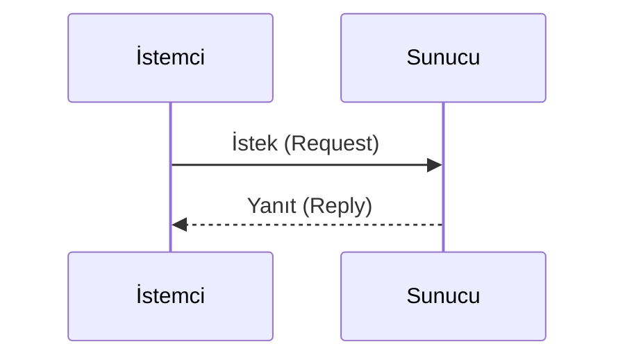
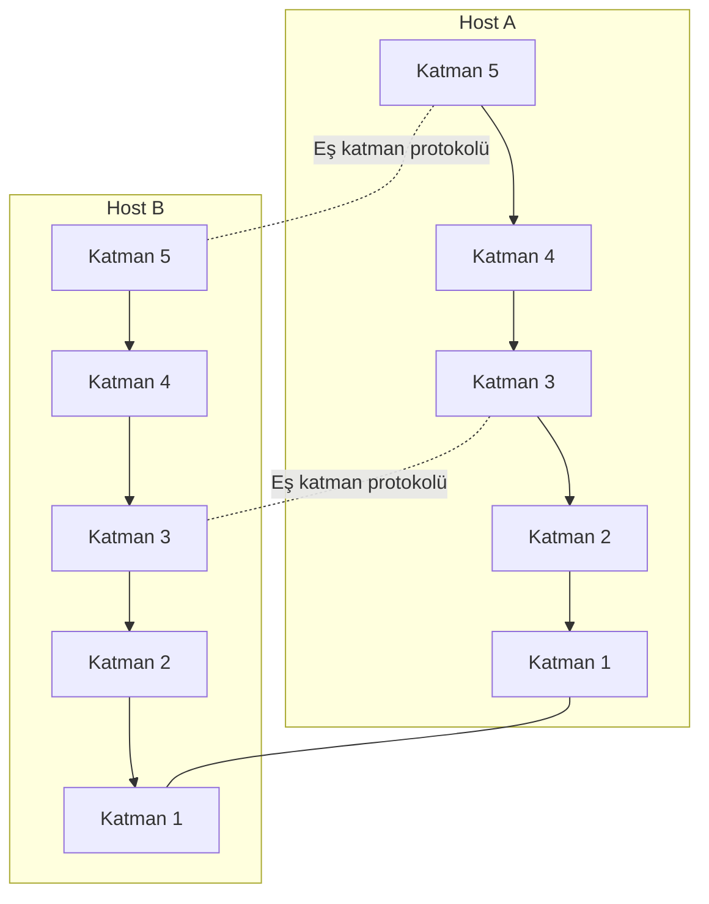
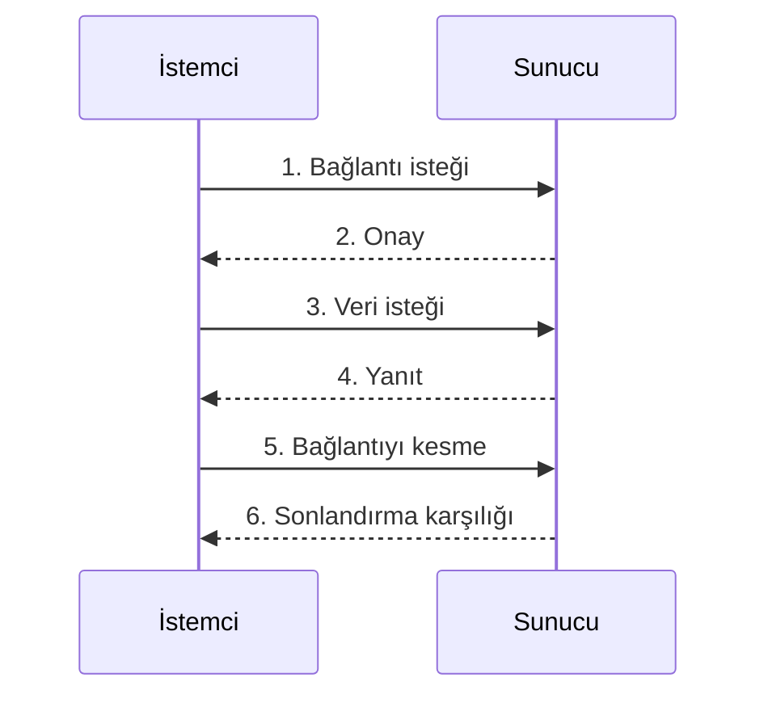

# Bilgisayar Ağları ve Veri İletişimi — Week 1

> [!info] Kullanım amacı
> Bu not, birlikte **Week 1'in 1–39. slaytları** üzerinden işlediğimiz açıklamaları, sınav için hazırlanmış örnek cevapları ve bilgi kontrol sorularını tek yerde toplar. Dersin dili Türkçe olduğundan anlatım Türkçedir; İngilizce teknik terimler parantez içinde verilmiştir. **Bu belge, ders PDF'inin birebir dökümü değil, konuşmamızdaki öğretici açıklamaların düzenlenmiş hâlidir.**
>
> **Kaynak:** [Ankara Üniversitesi — Ders sayfası](https://android.eng.ankara.edu.tr/dersler/802600715010-bilgisayar-aglari-ve-veri-iletisimi/) · [Week 1 PDF](https://android.eng.ankara.edu.tr/wp-content/uploads/sites/656/2017/09/Week_1.pdf) · [Chapter 1 örnek sorular](https://android.eng.ankara.edu.tr/wp-content/uploads/sites/656/2017/09/Chapter-1.pdf)

## İçindekiler

- [[#1. Slayt 1–5 — Bilgisayar ağı nedir?]]
- [[#2. Slayt 6–9 — Bilgisayar ağı ve dağıtık sistem]]
- [[#3. Slayt 10–13 — Ağlar neden kullanılır?]]
- [[#4. Slayt 14–17 — Ev uygulamaları, P2P ve mobilite]]
- [[#5. Slayt 18–22 — Ağ donanımları ve ağ sınıflandırması]]
- [[#6. Slayt 23–26 — LAN, MAN, WAN ve yönlendirme]]
- [[#7. Slayt 27–30 — Kablosuz ağlar ve ev ağları]]
- [[#8. Slayt 31–34 — Protokol hiyerarşileri ve kapsülleme]]
- [[#9. Slayt 35–39 — Ağ hizmetleri ve temel işlemler]]
- [[#10. Sınav için kavram kartları]]
- [[#11. Birlikte çözdüğümüz örnek sorular — Soru bankası]]
- [[#12. Örnek soruların cevap anahtarı]]
- [[#13. Önceki bilgi kontrollerinden çıkarılan kritik düzeltmeler]]
- [[#14. Week 1 genel tekrar sınavı]]

---

## 1. Slayt 1–5 — Bilgisayar ağı nedir?

### Slayt 1–3 — Giriş

Bilgisayar teknolojileri, tek ve büyük merkezi bilgisayarların kullanıldığı mimarilerden birbirleriyle iletişim kurabilen bağımsız bilgisayarlardan oluşan sistemlere doğru gelişmiştir. Bilgisayar ağları, fiziksel bağlantının ötesinde, bilgi ve kaynak paylaşımını sağlayan iletişim sistemleridir.

**Temel düşünce:** İki cihazın aynı odada bulunması ağ oluşturmaz; aralarında iletişim kurulabilmesi gerekir.

### Slayt 4 — Bilgisayar ağı (Computer Network)

> **Bilgisayar ağı:** Birbirine bağlanmış, kendi başına çalışabilen bağımsız bilgisayarların oluşturduğu iletişim sistemidir.

- **Interconnected — Birbirine bağlı:** Cihazlar veri alışverişi yapabilir.
- **Autonomous — Bağımsız:** Her bilgisayar bağımsız işlev görme kapasitesine sahiptir.
- Bağlantı bakır kablo, fiber optik veya kablosuz bir iletim ortamı üzerinden kurulabilir.

### Slayt 5 — Bağımsız bilgisayarlar

Bir bilgisayarın işlevinin tümüyle başka bir merkezi bilgisayarın denetimine bağımlı olduğu klasik **master–slave** düzeni, dersin ağ tanımındaki bağımsızlık özelliğini sağlamayabilir. Ancak bir bilgisayarın uzaktan yönetilebilmesi, bağımsız olmadığı anlamına **otomatik olarak** gelmez. Esas ölçüt, sistemin kendi işlevlerini bağımsız yerine getirebilmesidir.

> [!tip] Sınavda yaz
> Bilgisayar ağı, birbirine bağlı, bağımsız çalışabilen bilgisayarların veri ve kaynak paylaşmak amacıyla oluşturduğu iletişim sistemidir.

---

## 2. Slayt 6–9 — Bilgisayar ağı ve dağıtık sistem

### Slayt 6 — Şeffaflık (Transparency)

**Dağıtık sistem (Distributed System)**, farklı bilgisayarlarda yürütülen işlemleri kullanıcıya tek ve bütünleşik bir sistem gibi gösterebilir. Kullanıcı, belirli bir hesabın hangi düğümde (node) gerçekleştiğini bilmek zorunda değildir. Bu özelliğe **şeffaflık (transparency)** denir.

Örnek işlem sırası:

1. Kullanıcı bir analiz işi başlatır.
2. Dağıtık yazılım uygun düğümü seçer.
3. Gerekli dosyalar ve iş yükü ilgili düğüme aktarılır.
4. Hesaplama tamamlanır ve sonuç kullanıcıya sunulur.

### Slayt 7 — Ağ ve dağıtık sistem karşılaştırması

| Bilgisayar ağı | Dağıtık sistem |
|---|---|
| Birden fazla cihazın varlığı kullanıcıya açık olabilir. | Birden fazla cihazın varlığı kullanıcıdan soyutlanabilir. |
| Kullanıcı hedef bilgisayara açıkça bağlanabilir. | Sistem hedef düğümü otomatik seçebilir. |
| Kullanıcı dosya transferini kendisi başlatabilir. | Dosya transferi yazılım tarafından otomatik gerçekleştirilebilir. |
| Bağlantı ve kaynakların kullanımı daha görünür olabilir. | Kaynaklar tek sistem gibi sunulabilir. |

Örnek: SSH üzerinden belirli bir sunucuya bağlanmak klasik ağ etkileşimidir; analiz görevini otomatik olarak birçok işçi düğüme dağıtan platform dağıtık sisteme örnektir.

### Slayt 8 — Yazılımın rolü

Dağıtık sistem, bir ağın **üzerine kurulan yazılımsal bir örgütlenmedir**. Aynı fiziksel ağ, yalnızca bilgisayar ağı olarak kullanılabilir veya dağıtık bir yazılım sistemi çalıştırabilir.

- **Cohesiveness (Bütünlük):** Ayrı bileşenlerin koordineli biçimde tek sistem gibi çalışması.
- **Transparency (Şeffaflık):** Alttaki dağıtık yapının ayrıntılarının kullanıcıdan gizlenmesi.

### Slayt 9 — Temel farkı ortaya çıkaran örnek

Her iki sistemde de dosya transferi yapılabilir. Asıl fark işlemin **kim tarafından yönetildiği** ve kullanıcıya nasıl sunulduğudur. Ağ kullanımında kullanıcı bir hedef belirleyebilir; dağıtık sistemde bu seçim yazılım tarafından yapılabilir.

> [!tip] Sınavda yaz
> Dağıtık sistem, ağa bağlı bağımsız bilgisayarları yazılım aracılığıyla koordine ederek kullanıcıya tek ve bütünleşik bir sistem gibi sunan yapıdır. Temel özelliklerinden biri şeffaflıktır.

---

## 3. Slayt 10–13 — Ağlar neden kullanılır?

### Slayt 10 — Bilgisayar ağlarının kullanım gerekçeleri

| Neden | Açıklama | Örnek |
|---|---|---|
| **Kaynak paylaşımı (Resource Sharing)** | Ortak veri, yazılım ve donanım kullanımı | Merkezi veri tabanı |
| **Yüksek güvenilirlik (High Reliability)** | Arızalarda hizmetin sürdürülebilmesi | Yedek sunucu |
| **Maliyet tasarrufu (Saving Money)** | Kaynakların ortak kullanılmasıyla maliyetin düşürülmesi | Paylaşılan yazıcı |
| **Ölçeklenebilirlik (Scalability)** | Sistemin talep arttıkça genişletilebilmesi | Yeni sunucu eklemek |
| **İletişim (Communication Medium)** | İnsanlar ve uygulamalar arası haberleşme | E-posta, toplantı |

**Reliability ≠ Scalability**: Güvenilirlik hizmetin doğru/sürekli yürütülmesi ve arızalara dayanıklılıkla; ölçeklenebilirlik artan yükü karşılayacak şekilde büyüyebilmekle ilgilidir.

> [!warning] Dikkat
> Bir ağa bağlı olmak otomatik olarak güvenilirlik veya yüksek erişilebilirlik kazandırmaz. Yedeklilik, hata toleransı ve uygun sistem tasarımı gerekir.

### Slayt 11 — Ağların kullanım alanları

1. **Business Applications:** İşletmelerde veri ve kaynak paylaşımı.
2. **Home Applications:** İnternet, eğlence ve alışveriş.
3. **Mobile Users:** Hareket hâlindeki cihazların bağlantısı.
4. **Social Issues:** Güvenlik, gizlilik ve toplumsal/hukuki etkiler.

### Slayt 12 — İş uygulamalarında kaynak paylaşımı

Kaynak paylaşımı, ağdaki kullanıcıların ve uygulamaların ortak veri, program veya ekipmana erişebilmesidir. Örneğin öğretim üyelerinin aynı öğrenci notları veri tabanına erişmesi.

**Kritik ayrım:** Bu senaryoda paylaşılan kaynak, öncelikle **veri tabanı ve sunduğu hizmettir**. Sunucunun CPU'su veya RAM'i, söz konusu hizmeti çalıştıran altyapıdır; hocanın kaynak paylaşımı sorusunda asıl örnek öğrenci verileridir.

### Slayt 13 — İstemci–sunucu modeli (Client–Server)

- **İstemci (Client):** Hizmet veya kaynak talep eden yazılım süreci.
- **Sunucu (Server):** İstekleri işleyip yanıt döndüren yazılım süreci.
- **İstek–yanıt (Request–Reply):** İstemci isteği gönderir, sunucu cevap verir.

> [!note] Önemli nüans
> İnsan bilgisayarı kullanır; ağ iletişiminde istemci ve sunucu rolleri öncelikle **yazılım süreçlerine** aittir. Aynı fiziksel bilgisayar farklı uygulamalarda iki rolü de üstlenebilir.

> [!tip] Sınavda yaz
> İstemci–sunucu modeli, istemci süreçlerinin hizmet almak üzere sunucu süreçlerine istek gönderdiği ve sunucuların bu istekleri işleyerek yanıt verdiği ağ mimarisidir.

---

## 4. Slayt 14–17 — Ev uygulamaları, P2P ve mobilite

### Slayt 14 — Ev ağlarının kullanım amaçları

| Kategori | Örnek |
|---|---|
| Uzaktaki bilgiye erişim (Access to Remote Information) | Ders notu indirmek |
| Kişiler arası iletişim (Person-to-Person Communication) | E-posta, görüntülü görüşme |
| Etkileşimli eğlence (Interactive Entertainment) | Çevrim içi oyun |
| Elektronik ticaret (Electronic Commerce) | İnternetten alışveriş |

**Bilgiye erişim** ile **kişiler arası iletişim** farklı kullanımlardır: Birinde bilgi kaynağından içerik alınır, diğerinde insanlar haberleşir.

### Slayt 15 — Eşler arası ağ (Peer-to-Peer, P2P)

P2P sistemlerinde **sabit istemci ve sunucu rolleri olmak zorunda değildir**. Aynı düğüm hem dosya alabilir hem dosya gönderebilir.

Örnek: A, B'den dosya indirirken C'ye başka bir dosya sunar.

| Özellik | İstemci–Sunucu | P2P |
|---|---|---|
| Roller | Genellikle belirgin | Değişebilir |
| Kaynağın konumu | Çoğunlukla sunucular | Eş düğümler |
| Merkezi sunucu | Genellikle mevcut | Zorunlu değil |
| Örnek | Web sitesi | BitTorrent |

Bazı P2P sistemleri eşleri bulmak için merkezi koordinasyon hizmeti kullanabilir; P2P her zaman tamamen merkeziyetsiz demek değildir.

### Slayt 16 — Elektronik ticaret türleri

| Kısaltma | Açılım | Örnek |
|---|---|---|
| **B2C** | Business-to-Consumer | Şirketin kişiye kitap satması |
| **B2B** | Business-to-Business | Üreticinin tedarikçiden parça alması |
| **G2C** | Government-to-Consumer | Devletin çevrim içi hizmet sunması |
| **C2C** | Consumer-to-Consumer | İki kişi arasında ikinci el satış |
| **P2P** | Peer-to-Peer | Eşler arası dosya paylaşımı (slayttaki sınıflandırma) |

P2P, burada örnek olarak geçmesine rağmen öncelikle bir **ağ mimarisi** kavramıdır; her P2P uygulaması ticaret değildir.

### Slayt 17 — Kablosuz ve mobil aynı şey değildir

- **Kablosuz (Wireless):** Verinin fiziksel kablo olmadan taşınması.
- **Mobil (Mobile):** Cihazın farklı konumlarda kullanılabilmesi / hareket edebilmesi.

| Kablosuz mu? | Mobil mi? | Örnek |
|---|---|---|
| Hayır | Hayır | Sabit masaüstü, Ethernet |
| Hayır | Evet | Taşınabilen dizüstü, kablolu bağlantı |
| Evet | Hayır | Yerinden oynamayan Wi-Fi masaüstü |
| Evet | Evet | Hareket hâlindeki telefon ve mobil veri |

> [!tip] Sınavda yaz
> Bir bilgisayar mobil olup kablosuz olmayabilir. Örneğin dizüstü bilgisayar farklı konumlara taşınabilir ancak her konumda Ethernet kablosuyla bağlanabilir.

---

## 5. Slayt 18–22 — Ağ donanımları ve ağ sınıflandırması

### Slayt 18 — Ağ kategorileri

- **LAN:** Yerel alan ağı.
- **MAN:** Metropol alan ağı.
- **WAN:** Geniş alan ağı.
- **Wireless Network:** Kablosuz ağ.
- **Home Network:** Ev ağı.
- **Internetwork:** Birbirine bağlanmış ayrı ağlardan oluşan yapı.

Bu sınıflar farklı ölçütlere dayanır; örneğin bir kablosuz ağ, aynı zamanda LAN olabilir.

### Slayt 19 — İletim teknolojisine göre ayrım

1. **Broadcast links:** Ortak iletişim kanalını paylaşan cihazlar.
2. **Point-to-point links:** Belirli cihaz çiftleri arasındaki bağlantılar.

### Slayt 20 — Yayın tipi ağ (Broadcast Network)

Birden fazla cihaz aynı iletişim kanalını paylaşır. Ortam üzerinden gönderilen çerçeveler diğer cihazlar tarafından alınabilir, ancak her cihaz her çerçeveyi mutlaka uygulama düzeyinde işlemek zorunda değildir. Hedef adresi çerçevenin nasıl ele alınacağını belirleyebilir.

**Noktadan noktaya (Point-to-Point):** Bağlantı iki cihaz arasında bulunur. Kaynak ile hedef arasında doğrudan bağlantı yoksa veri ara düğümlerden geçebilir.

| Özellik | Broadcast ağ | Point-to-point ağ |
|---|---|---|
| Bağlantı mantığı | Ortak kanal | Cihaz çifti arasındaki bağlantı |
| İletim | Paylaşılan ortam | Belirli hat/bağlantı |
| Örnek | Klasik ortak veri yollu Ethernet | İki router arasındaki özel hat |

### Slayt 21 — Küçük ve büyük ağlarda genel eğilim

Klasik sınıflandırmada küçük ağlar ortak kanal (broadcast), büyük ağlar cihaz çiftleri arasındaki bağlantılar (point-to-point) kullanmaya daha yatkın gösterilir. **Gerekçe:** Mesafe, cihaz sayısı, kapasite ve ölçeklenme ihtiyaçları büyür.

> [!warning] Modern ağlarda istisna
> Bu tarihsel bir genellemedir: Günümüz anahtarlamalı Ethernet LAN'larında cihaz–anahtar bağlantıları çoğunlukla fiziksel olarak point-to-point biçimindedir. Ayrıca büyük bir ağın point-to-point kullanmasının tek nedeni **güvenlik** değildir.

### Slayt 22 — Yaklaşık ölçeklere göre ağ türleri

| Yaklaşık mesafe | Ölçek | Tür |
|---|---|---|
| 1 m | Kişisel alan | PAN |
| 10 m | Oda | LAN |
| 100 m | Bina | LAN |
| 1 km | Kampüs | LAN |
| 10 km | Şehir | MAN |
| 100 km | Ülke ölçeği | WAN |
| 1.000 km | Kıta | WAN |
| 10.000 km | Gezegen | İnternet |

Sayılar **yaklaşık örneklerdir**, sert teknik sınırlar değildir.

### Ek: Unicast / Multicast / Broadcast ile ağ yapısını karıştırma

| İletim biçimi | Alıcılar | Örnek |
|---|---|---|
| **Unicast** | Tek hedef | Bir istemciye web yanıtı |
| **Multicast** | Belirli üye grubu | Multicast grubuna video |
| **Broadcast** | İlgili yayın alanındaki tüm cihazlar | ARP isteği (Ethernet) |

**Broadcast network** = İletişim ortamının paylaşılma biçimi. **Broadcast transmission** = Mesajın kimlere gönderildiği. Bunlar aynı soru değildir.

**TCP ile e-posta gönderme, point-to-point fiziksel topolojiye örnek değildir.** TCP, taşıma katmanı protokolüdür; veri birden fazla ağ ve bağlantıdan geçebilir.

---

## 6. Slayt 23–26 — LAN, MAN, WAN ve yönlendirme

### Slayt 23 — Klasik LAN topolojileri

#### Bus (Veri yolu)

Bütün cihazlar ortak ana iletişim hattına bağlanır. Paylaşılan ortamda eş zamanlı iletimler çakışmaya neden olabilir; ana hattaki arıza iletişimi etkileyebilir.

#### Ring (Halka)

Cihazlar kapalı halka şeklinde bağlanır. Veri halka boyunca ilerler. Bazı klasik halka sistemleri **token passing (jeton dolaştırma)** ile erişimi düzenler.

| Bus | Ring |
|---|---|
| Ortak ana hat | Kapalı halka bağlantıları |
| Paylaşılan ortam | Halka boyunca veri akışı |
| Çakışma görülebilir | Jetonla erişim kontrol edilebilir |

> [!note] Modern örnek
> Yıldız topolojili anahtarlamalı Ethernet de yaygındır; slaytın bus/ring şekilleri klasik LAN mimarilerini açıklar.

### Slayt 24 — MAN örneği

MAN, şehir ölçeğinde kullanıcıları veya farklı ağları birbirine bağlayabilir. Dersin örneğinde **kablo televizyon altyapısı** üzerinden ağ hizmeti gösterilmiştir.

- **Head End:** Kablo ağı merkez toplama/dağıtım noktası.
- **Junction Box:** Hatların bağlandığı/ayrıldığı nokta.
- **Internet:** Dış ağ erişimi.

### Slayt 25 — WAN bileşenleri

- **Host (Ana makine):** Ağ üzerinde uygulamaların çalıştığı, veri üreten/alan uç sistem.
- **Router (Yönlendirici):** Paketleri farklı ağlar arasında uygun sonraki bağlantıya ileten cihaz.
- **Communication Subnet (İletişim alt ağı):** Dersin klasik kullanımında host'lar arasındaki iletişimi sağlayan router'lar ve bağlantılar.

> [!warning] Subnet teriminin iki kullanımı
> Buradaki **communication subnet**, iletişim altyapısı anlamındadır. Modern IP adreslemede **IP subnet**, bir IP adres bloğunun alt ağını ifade edebilir. Bağlamı ayır.

### Slayt 26 — Paket akışı, routing ve forwarding

Örnek rota: **Kaynak → A → C → E → Hedef**. Paket ara yönlendiriciler üzerinden ilerler.

- **Routing (Yol belirleme/yönlendirme):** Uygun rotaların hesaplanması veya yönlendirme bilgilerinin oluşturulması.
- **Forwarding (Paket iletme):** Gelen paketin yönlendirme/iletim tablosuna göre bir çıkış arayüzünden gönderilmesi.

**Örnek:** C yönlendiricisinin tablosunda hedef için sonraki atlama E ise, C'nin paketi E'ye göndermesi **forwarding**'dir. Bu bilginin belirlenmesi **routing** sürecine dayanır. Routing her zaman tek ve mutlak anlamda en kısa yolu seçmek değildir; algoritma ve metrik önemlidir.

> [!tip] Sınav için dört terim
> **Host** uç sistem. **Subnet** router ve iletişim hatları. **Routing** yol bilgisi oluşturma. **Forwarding** paketi çıkıştan iletme.

---

## 7. Slayt 27–30 — Kablosuz ağlar ve ev ağları

### Slayt 27 — Kablosuz ağ türleri

| Kategori | Kullanım | Örnek |
|---|---|---|
| **System Interconnection** | Yakın cihaz bağlantısı | Bluetooth fare |
| **Wireless LAN** | Yerel kablosuz ağ erişimi | Wi-Fi |
| **Wireless WAN** | Geniş coğrafyada kablosuz iletişim | Hücresel 4G/5G |

### Slayt 28 — Bluetooth ve kablosuz LAN

**Bluetooth:** Bilgisayar ile klavye, fare, kulaklık gibi çevre birimleri arasında iletişim.

**Kablosuz LAN:** İstemcilerin erişim noktası (access point) üzerinden yerel ağa ve gerekirse kablolu altyapıya bağlanması.

Örnek akış: Dizüstü → Wi-Fi erişim noktası → Kablolu ağ → Sunucu.

Erişim noktası kullanmayan kablosuz ağ biçimleri de olabilir; slayt altyapı modunu örnekler.

### Slayt 29 — Bireysel mobil bağlantı ve uçan LAN

- **Bireysel bağlantı:** Uçakta her bilgisayar dış dünya ile ayrı bağlantı kurabilir.
- **Uçan LAN (Flying LAN):** Uçaktaki bilgisayarlar ortak yerel ağ oluşturur; bir yönlendirici üzerinden dış bağlantıyı paylaşabilir.

Uçan LAN'ın amacı, cihazlar aynı hareketli platform üzerindeyken yerel iletişimi ve ortak bağlantıyı düzenleyebilmektir.

### Slayt 30 — Ev ağlarında cihaz kategorileri

| Kategori | Örnekler |
|---|---|
| Bilgisayarlar | Masaüstü, dizüstü, çevre birimleri |
| Eğlence | Televizyon, kamera, ses sistemi |
| Telekomünikasyon | Telefon, mobil cihaz |
| Ev cihazları | Buzdolabı, klima, ışıklar |
| Telemetri | Sayaç, duman alarmı, izleme sensörü |

**Telemetri (Telemetry):** Bir cihazın ölçüm veya durum verilerini uzak izleme/kontrol sistemine aktarmasıdır. Örnek: Akıllı elektrik sayacı, duman sensörü.

**IoT**, ağ bağlantılı nesneleri kapsayan geniş bir kavramdır. Ev ağı ise evdeki cihazları bağlayan ağ altyapısını ifade eder; bunlar birebir eş anlamlı değildir.

---

## 8. Slayt 31–34 — Protokol hiyerarşileri ve kapsülleme

### Slayt 31 — Ağ yazılımlarına giriş

Ana alt başlıklar:

1. Protokol hiyerarşileri
2. Katmanların tasarım sorunları
3. Bağlantılı ve bağlantısız hizmetler
4. Hizmet temel işlemleri
5. Hizmet ve protokol ilişkisi

**Katmanlı mimari neden kullanılır?** Karmaşık iletişim işlerini yönetilebilir parçalara ayırır; modülerlik, standartlaşma, bakım kolaylığı ve birlikte çalışabilirliği artırır.

### Slayt 32 — Katman, protokol, arayüz

- **Katman (Layer):** Belirli iletişim işlevinden sorumlu mantıksal seviye.
- **Protokol (Protocol):** Farklı sistemlerdeki **eş katmanların** uyması gereken iletişim kuralları.
- **Arayüz (Interface):** Aynı sistemdeki **komşu katmanların** hizmet alışverişi düzeni.

**Yatay ilişki → protokol**; **dikey ilişki → arayüz/hizmet**.

Örnek beş katmanlı öğretim düzeni: Uygulama, Taşıma, Ağ, Veri Bağlantı, Fiziksel. Hocanın şeması ise bunları isimlendirmeden 1–5 numarasıyla gösterir.

> [!important] Eş katmanların iletişimi mantıksaldır
> Veri fiziksel olarak gönderen host'ta **aşağı**, alıcı host'ta **yukarı** ilerler. Yatay çizgiler doğrudan fiziksel kanal anlamına gelmez.

### Slayt 33 — Filozof–Çevirmen–Sekreter örneği

Üç seviyeli benzetme:

1. **Filozof (üst katman):** Düşünceyi/mesajı oluşturur.
2. **Çevirmen (ara katman):** Mesajı karşı tarafta anlaşılacak ortak biçime dönüştürür.
3. **Sekreter (alt katman):** Mesajı fiziksel iletişim sistemiyle gönderir/alır.

Gönderici: Filozof → Çevirmen → Sekreter → Fiziksel bağlantı. Alıcı: Fiziksel bağlantı → Sekreter → Çevirmen → Filozof.

**Ders çıkarımı:** Eş görevli kişiler arasında ortak kurallar vardır, ancak gerçek taşıma alt seviyeler üzerinden gerçekleşir.

### Slayt 34 — Kapsülleme (Encapsulation)

Gönderen üst katmanda mesaj **M** oluşur. Alt katmanlara indikçe başlıklar (header) ve gerektiğinde son ek (trailer) eklenir.

| Aşama | Veri birimi |
|---|---|
| Katman 5 | `M` |
| Katman 4 | `H₄ | M` |
| Katman 3 (örnekte ikiye bölme) | `H₃ | H₄ | M₁` ve `H₃ | M₂` |
| Katman 2 birinci parça | `H₂ | H₃ | H₄ | M₁ | T₂` |
| Katman 2 ikinci parça | `H₂ | H₃ | M₂ | T₂` |

- **H₂/H₃/H₄:** İlgili katmanın kontrol bilgisi başlıkları.
- **T₂:** Veri bağlantı katmanının son ek kontrol bilgisi; örneğin Ethernet FCS.
- **M₁/M₂:** Bu özel çizimde ikiye ayrılan üst katman verisi.

> [!warning] Şemaya özgü ayrıntı
> İkinci parçada **H₄ olmaması**, örnekte H₄'ün birinci parçaya yerleşmesi nedeniyledir. Her protokolde her mesaj tam olarak ikiye bölünmez; bölme/yeni birleştirme de her sistemde aynı katmanda yapılmaz.

**Kapsül açma (Decapsulation):** Alıcıda ilgili katmanlar kendi kontrol bilgilerini işler; özgün üst katman mesajı teslim edilir.

**Sanal iletişim (Virtual Communication):** Eş katmanlar doğrudan haberleşiyormuş gibi görünür; gerçek aktarım katmanların aşağı/yukarı işleyişine dayanır.

---

## 9. Slayt 35–39 — Ağ hizmetleri ve temel işlemler

### Slayt 35 — Katmanların tasarım sorunları

| Kavram | Sorusu | Temel görev |
|---|---|---|
| **Adresleme (Addressing)** | Veri kime gidecek? | Kaynak/hedef tanımlama |
| **Hata kontrolü (Error Control)** | Veri bozuldu/kayboldu mu? | Hata tespiti, düzeltme ve telafi |
| **Akış kontrolü (Flow Control)** | Alıcı yetişebiliyor mu? | Gönderimi alıcının kapasitesine göre düzenleme |
| **Çoklama (Multiplexing)** | Tek kaynağı kaç akış kullanıyor? | Birden fazla akışı ortak kaynakta taşıma |
| **Yönlendirme (Routing)** | Hangi yoldan gidecek? | Rota seçimi/yönlendirme bilgisi |

**Adresleme örnekleri:** MAC (yerel bağlantı), IP (ağlar arası hedefleme), port (uygulama iletişim uç noktası).

**Hata örneği:** Gönderilen `10110010`, alınan `10100010` → bit değişimi. CRC ve Hamming hata kontrolüyle ilgilidir.

**Akış kontrolü örneği:** Hızlı gönderici, yavaş alıcının tamponunu doldurmasın diye veri akışı düzenlenir. TCP alıcı penceresi buna örnektir.

**Çoklama örneği:** Bir bilgisayardaki birden fazla uygulama, ortak ağ bağlantısını kullanır. Fiziksel katmanda zaman/frekans paylaşımı uygulanabilir.

> [!tip] Kesin ayrım
> **Hata kontrolü:** Veri doğru ulaştı mı? **Akış kontrolü:** Alıcı veriyi işleyebiliyor mu?

### Slayt 36 — Bağlantılı ve bağlantısız hizmetler

**Bağlantı odaklı (Connection-Oriented):** Genellikle 1) Bağlantı kur, 2) Veri aktar, 3) Bağlantıyı sonlandır aşamalarından oluşur. TCP bağlantı odaklı, güvenilir ve sıralı **bayt akışı** sağlar.

**Bağlantısız (Connectionless):** Önceden bağlantı kurma zorunluluğu olmadan veri birimleri bağımsız gönderilebilir. UDP yaygın örnektir.

**İki ayrı boyut:** Bağlantılı olmak ≠ otomatik olarak güvenilir olmak; bağlantısız olmak ≠ güvenilirlik mekanizması asla kullanılamaz demek.

| Hizmet | Bağlantı sınıfı | Slayttaki benzetme/örnek |
|---|---|---|
| Güvenilir mesaj akışı | Bağlantılı | Sıralı sayfalar |
| Güvenilir bayt akışı | Bağlantılı | Uzak oturum |
| Güvenilir olmayan bağlantı | Bağlantılı | Sayısallaştırılmış ses |
| Güvenilir olmayan datagram | Bağlantısız | İstenmeyen e-posta (benzetme) |
| Onaylı datagram | Bağlantısız | Taahhütlü posta |
| İstek–yanıt | Bağlantısız | Veri tabanı sorgusu |

**Güvenilir mesaj akışı:** Mesaj sınırları korunur, mesajlar güvenilir biçimde iletilir.

**Güvenilir bayt akışı:** Sıralı baytlar sunulur; uygulama mesaj sınırları kendiliğinden korunmaz.

**Güvenilir olmayan bağlantı:** Mantıksal bağlantı vardır, her veri biriminin kayıpsız teslimi garanti değildir.

**Güvenilir olmayan datagram:** Bağımsız veri birimleri teslim garantisi olmadan gönderilir.

**Onaylı datagram:** Bağlantısız gönderime ilişkin alındı onayı sağlanır.

**İstek–yanıt:** Talep gönderilir ve karşılık alınır.

> [!warning] E-posta benzetmesi
> “İstenmeyen e-posta” örneği, slayttaki gündelik benzetmedir; gerçek e-posta taşıma protokolünün UDP gibi güvenilir olmayan datagram kullandığı anlamına gelmez.

### Slayt 37 — Hizmet temel işlemleri (Service Primitives)

| İşlem | Anlamı |
|---|---|
| **LISTEN** | Gelen bağlantıyı bekle |
| **CONNECT** | Bağlantı kur |
| **RECEIVE** | Gelen mesajı bekle/al |
| **SEND** | Mesaj gönder |
| **DISCONNECT** | Bağlantıyı sonlandır |

**LISTEN ≠ RECEIVE**: İlki bağlantı isteğini, ikincisi veri mesajını beklemekle ilgilidir. SEND bağlantı kurma işlemi değildir.

Bu işlemler basitleştirilmiş hizmet modelidir; gerçek soket API'leri daha fazla işlev içerebilir.

### Slayt 38 — Altı mesajlı istemci–sunucu örneği

1. İstemciden sunucuya **bağlantı isteği**.
2. Sunucudan istemciye **bağlantı onayı**.
3. İstemciden sunucuya **veri isteği**.
4. Sunucudan istemciye **yanıt**.
5. İstemciden sunucuya **bağlantıyı kesme isteği**.
6. Sunucudan istemciye **sonlandırma karşılığı**.

**Kernel:** İşletim sistemi çekirdeği. **Protocol Stack:** İletişim protokollerinin uygulandığı yığın. **Driver:** Ağ donanımıyla iletişimi sağlayan sürücü. **System Call:** Uygulamanın işletim sisteminden hizmet isteme yolu.

> [!warning] TCP ile karıştırma
> Slayt 38, **soyut ve basitleştirilmiş hizmet akışıdır**. TCP'nin üç yönlü el sıkışmasının veya FIN/ACK paketlerinin birebir gösterimi değildir.

### Slayt 39 — Hizmet, protokol, arayüz

| Kavram | Cevapladığı soru | İlişki |
|---|---|---|
| **Hizmet (Service)** | **Ne** sunuluyor? | Alt katmanın üst katmana sunduğu işlev |
| **Protokol (Protocol)** | **Hangi kurallarla** iletişim kuruluyor? | Farklı sistemlerin eş katmanları |
| **Arayüz (Interface)** | **Hizmet nasıl** kullanılıyor? | Aynı sistemin komşu katmanları |

**Örnek:** Taşıma katmanı uygulamaya güvenilir bayt akışı **hizmeti** sunabilir; bunun gerçekleştirilmesi için TCP **protokolü** kullanılır; uygulama işletim sisteminin soket **arayüzü** aracılığıyla hizmete erişir.

> [!tip] Sınavda yaz
> Hizmet, katmanın üst katmana sunduğu işlevdir. Protokol, farklı sistemlerdeki eş katmanların uyması gereken iletişim kurallarıdır. Arayüz, aynı sistemdeki komşu katmanlar arasında hizmete erişim biçimidir. Kısaca: **Hizmet = ne, protokol = hangi kurallar, arayüz = nasıl erişilir.**

---

## 10. Sınav için kavram kartları

> [!abstract] Hızlı tekrar — Önce cevabı kapatıp kendin söyle

| Soru | Kısa cevap |
|---|---|
| Ağın iki temel özelliği? | Bağlılık ve bağımsızlık |
| Dağıtık sistemin ayırt edici özelliği? | Tek bütün gibi görünme/şeffaflık |
| Ağ kullanmanın beş amacı? | Kaynak, güvenilirlik, maliyet, ölçek, iletişim |
| İstemci–sunucu mantığı? | İstek–yanıt |
| P2P'de roller? | Düğüm hem istemci hem sunucu olabilir |
| Mobile/Wireless farkı? | Hareketlilik / kablosuz iletim |
| LAN/MAN/WAN? | Yerel / şehir / geniş alan |
| Broadcast ağ? | Ortak iletişim kanalı |
| Point-to-point? | Cihaz çifti arasındaki bağlantı |
| Multicast? | Belirli alıcı grubuna iletim |
| Bus/Ring? | Ortak hat / kapalı halka |
| Host? | Uç sistem |
| Communication subnet? | Router'lar ve iletişim hatları |
| Routing/Forwarding? | Yol bilgisi / paketi iletme |
| Bluetooth/Wi-Fi/5G? | Yakın cihaz / yerel kablosuz / geniş kablosuz |
| Telemetri? | Uzaktan ölçüm veya durum bilgisi iletimi |
| Protokol? | Eş katman iletişim kuralları |
| Arayüz? | Komşu katmanların etkileşimi |
| Kapsülleme? | Başlık/son ek ekleyerek taşıma |
| Hata kontrolü? | Veri hatası/kaybının yönetimi |
| Akış kontrolü? | Alıcının kapasitesine göre gönderim |
| Multiplexing? | Ortak kaynağı çoklu akışa kullandırma |
| TCP/UDP? | Bağlantılı güvenilir bayt akışı / bağlantısız datagram |
| LISTEN/RECEIVE? | Bağlantı bekle / veri al |
| Service/Protocol/Interface? | Ne / hangi kurallar / nasıl erişilir |

---

## 11. Birlikte çözdüğümüz örnek sorular — Soru bankası

> [!info] Çalışma yöntemi
> Önce yalnızca bu bölümün sorularını çöz. Daha sonra [[#12. Örnek soruların cevap anahtarı]] bölümüne git. Sorular önceki sohbetimizde kullanılan **öğrenme amaçlı örnek sorulardır**; hocanın resmî sınavında aynen çıkacağı iddia edilmez. Bazı konular hocanın yayımladığı Chapter 1 örnek soru başlıklarıyla örtüşür.

### Test A — Slayt 1–5 (2 soru)

**A1.** Bir bilgisayar ağının iki temel özelliği hangisidir?

- A) Yüksek işlem gücü ve depolama
- B) Birbirine bağlılık ve bağımsızlık
- C) Merkezi kontrol ve ortak bellek
- D) İnternet erişimi ve kablosuz bağlantı

**A2.** Ağ tanımında bilgisayarların bağımsız (autonomous) olması neden önemlidir?

### Test B — Slayt 6–9 (3 soru)

**B1.** Bilgisayar ağı ve dağıtık sistem arasındaki temel ayrımı en iyi hangi ifade verir?

- A) Dağıtık sistemler her zaman kablosuzdur.
- B) Dağıtık sistem, birden fazla bilgisayarın varlığını kullanıcıdan gizleyebilir.
- C) Bilgisayar ağında dosya transferi yapılamaz.
- D) Dağıtık sistemler ağ gerektirmez.

**B2.** Dağıtık sistemlerde şeffaflık (transparency) nedir?

**B3.** Öğrenci analiz programını çalıştırıyor; sistem uygun sunucuyu otomatik seçiyor, hesaplama yapıyor ve sonucu gösteriyor. Bu neden dağıtık sistem örneğidir?

### Test C — Slayt 10–13 (4 soru)

**C1.** Ölçeklenebilirlik (scalability) nedir?

- A) Bütün ağ arızalarını önlemek
- B) Sistem kapasitesini/performansını kademeli artırabilmek
- C) Her mesajı şifrelemek
- D) Tek merkezi bilgisayar kullanmak

**C2.** Güvenilirlik (reliability) ile ölçeklenebilirlik (scalability) farkını açıkla.

**C3.** Üniversitenin merkezi sunucusundaki öğrenci notlarına öğretim üyeleri kendi bilgisayarlarından erişiyor. İstemci, sunucu ve paylaşılan kaynağı belirt.

**C4.** İstemci–sunucu modelini istek–yanıt üzerinden tanımla.

### Test D — Slayt 14–17 (4 soru)

**D1.** P2P için doğru ifade hangisidir?

- A) Her iletişim merkezi sunucudan geçer.
- B) Bir eş düğüm hem istemci hem sunucu olabilir.
- C) Yalnızca sunucular dosya paylaşabilir.
- D) P2P her zaman kablosuzdur.

**D2.** İstemci–sunucu ve P2P modellerini merkezi sunucu, roller ve kaynak paylaşımı bakımından karşılaştır.

**D3.** Bilgisayar mobil olup kablosuz olmayabilir mi? Örnek ver.

**D4.** Otomobil üreticisi başka bir şirketten internet üzerinden lastik alıyor. Ticaret türü hangisidir?

- A) B2C
- B) C2C
- C) B2B
- D) G2C

### Test E — Slayt 18–22 (5 soru)

**E1.** Yayın tipi ağ (broadcast network) nedir? Ortak iletişim kanalını açıkla.

**E2.** Noktadan noktaya ağ ile yayın tipi ağ farkı nedir? Örnek ver.

**E3.** Aynı şehirdeki üniversite kampüsleri şehir ölçeğinde bağlanıyor. En uygun kategori hangisidir?

- A) PAN
- B) MAN
- C) WAN
- D) P2P

**E4.** Unicast, multicast ve broadcast arasındaki farkları örneklerle açıkla.

**E5.** Büyük ağlarda yalnızca tek ortak kanala dayalı iletişimin sınırlamaları nelerdir? Neden çok sayıda point-to-point bağlantı kullanılabilir?

### Test F — Slayt 23–26 (4 soru)

**F1.** Bus ve Ring topolojilerini karşılaştır.

**F2.** WAN'da host, router ve communication subnet nedir?

**F3.** Yönlendirici paketi tablosuna göre çıkış arayüzünden gönderiyor. Bu işlem hangisidir?

- A) Resource Sharing
- B) Forwarding
- C) Framing
- D) Multiplexing

**F4.** Paket A → C → E üzerinden gidiyor; C'nin paketi D yerine E'ye iletmesini routing ve forwarding açısından açıkla.

### Test G — Slayt 27–30 (4 soru)

**G1.** Kablosuz geniş alan ağına örnek hangisidir?

- A) Bluetooth klavye
- B) Mobil operatörün 5G ağı
- C) Ev Wi-Fi ağı
- D) USB yazıcı

**G2.** Bluetooth türü sistemler arası bağlantı ile kablosuz LAN arasındaki fark nedir?

**G3.** Uçakta 50 yolcunun bilgisayarı ortak bir LAN'a ve tek yönlendiriciye bağlanıyor. Neden uçan LAN denir? Avantajları nelerdir?

**G4.** Telemetri nedir? Ev ağından iki örnek ver.

### Test H — Slayt 31–34 (5 soru)

**H1.** Protokol/arayüz farkını hangi ifade doğru açıklar?

- A) Protokoller yalnız fiziksel katmandadır.
- B) Protokoller eş katman kurallarını, arayüzler komşu katman etkileşimini tanımlar.
- C) Arayüz yalnız farklı bilgisayarlar arasındadır.
- D) İkisi tamamen aynıdır.

**H2.** Ağlarda neden katmanlı mimari kullanılır? İki avantajını açıkla.

**H3.** Filozof–Çevirmen–Sekreter modelinde filozoflar neden doğrudan fiziksel iletişim kurmaz? Diğer iki seviyenin rolü nedir?

**H4.** Beşinci katmanda M oluşturuluyor, dördüncü katman H₄ ekliyor, üçüncü katman mesajı ikiye ayırıp H₃ ekliyor, ikinci katman H₂ ve T₂ ekliyor. İki veri biriminin sıralamasını yaz.

**H5.** Sanal iletişim (virtual communication) hangisidir?

- A) Eş katmanların mantıksal iletişimi
- B) Her katmanın ayrı kablo kullanması
- C) Her verinin şifreli olması
- D) Ağ olmadan mesaj iletimi

### Test I — Slayt 35–39 (5 soru)

**I1.** Hata kontrolü ile akış kontrolünün farkını örneklerle açıkla.

**I2.** Bağlantılı ve bağlantısız hizmetleri TCP/UDP üzerinden karşılaştır. Bağlantı her zaman güvenilirlik sağlar mı?

**I3.** Sunucu yeni bağlantı isteğini bekliyor. Hangi işlem kullanılır?

- A) SEND
- B) LISTEN
- C) RECEIVE
- D) DISCONNECT

**I4.** Slayt 38'deki soyut istemci–sunucu iletişiminin altı mesajını sırasıyla yaz.

**I5.** Hizmet, protokol ve arayüz arasındaki farkı ve katmanlı mimarideki yerlerini açıkla.

---

## 12. Örnek soruların cevap anahtarı

> [!success] A — Slayt 1–5
> **A1:** B. **A2:** Ağdaki bilgisayarlar birbirleriyle iletişim kurarken kendi işlevlerini bağımsız yürütebilmelidir. Tamamen merkezi kontrol bağımlılığı, dersin öne çıkardığı özerklik niteliğine uymaz.

> [!success] B — Slayt 6–9
> **B1:** B. **B2:** Dağıtık yapının ve kaynakların nerede/kimde olduğunun kullanıcıdan soyutlanması; sistemin tek bütün gibi görünmesi. **B3:** Kullanıcı yalnızca iş talep eder; işin hangi düğümde yapılacağına, veri transferine ve sonucun toplanmasına dağıtık yazılım karar verir.

> [!success] C — Slayt 10–13
> **C1:** B. **C2:** Reliability, arıza koşullarında doğru/sürekli çalışabilme; scalability, artan iş yükünü karşılamak için kapasiteyi artırabilmedir. **C3:** İstemci = öğretim üyesinin kullandığı uygulama; sunucu = merkezi hizmeti sunan uygulama/sistem; paylaşılan kaynak = öğrenci notları veri tabanı/hizmeti. **C4:** İstemci istek gönderir, sunucu isteği işler ve yanıt döndürür.

> [!success] D — Slayt 14–17
> **D1:** B. **D2:** Client–server modelinde belirli sunucular hizmet sunar; P2P'de düğümler hem kaynak tüketip hem sunabilir, roller sabit değildir. **D3:** Evet; taşınabilir dizüstü bilgisayarın Ethernet kablosuyla bağlanması. **D4:** C (B2B).

> [!success] E — Slayt 18–22
> **E1:** Ortak iletişim kanalı kullanan cihazların oluşturduğu ağ; herkes her çerçeveyi işlemek zorunda değildir. **E2:** Broadcast ortak kanal, point-to-point cihaz çifti arasındaki bağlantıdır. Örnek: paylaşımlı eski Ethernet / iki router arası hat. **E3:** B (MAN). **E4:** Unicast tek alıcıya (tek istemciye yanıt), multicast seçilmiş gruba (IP multicast grubu), broadcast yayın alanının tamamına (ARP isteği). **E5:** Cihaz sayısı/mesafe arttıkça ortak kanalın erişim ve kapasite sorunları artar; point-to-point ile yönlendirilen yapı ölçeklenebilirlik sağlar.

> [!success] F — Slayt 23–26
> **F1:** Bus ortak ana hat; Ring kapalı halka. **F2:** Host uç sistem; router paketleri bir sonraki bağlantıya ileten cihaz; communication subnet router ve iletişim hatları bütünüdür. **F3:** B. **F4:** Routing hedefe ilişkin yol bilgisinin oluşturulması, forwarding C'nin gelen paketi tablosuna göre E'ye göndermesidir.

> [!success] G — Slayt 27–30
> **G1:** B (5G). **G2:** Bluetooth yakın cihaz iletişimi, kablosuz LAN ev/ofis/kampüs gibi yerel ağ bağlantısıdır. **G3:** Uçak hareket etse de içindeki bilgisayarlar bir yerel ağ oluşturur; ortak yönlendirici dış bağlantı sunar, yönetimi ve paylaşımı kolaylaştırabilir. **G4:** Ölçüm/durum verisinin uzaktan iletimi; akıllı sayaç ve duman sensörü.

> [!success] H — Slayt 31–34
> **H1:** B. **H2:** Katmanlama karmaşıklığı yönetir; modülerlik, bakım, standartlaşma ve uyumluluk sağlar. **H3:** Filozof mesajı oluşturur, çevirmen biçim/dil dönüşümünü yapar, sekreter fiziksel taşımayı gerçekleştirir. **H4:** `H₂ | H₃ | H₄ | M₁ | T₂` ve `H₂ | H₃ | M₂ | T₂`. **H5:** A.

> [!success] I — Slayt 35–39
> **I1:** Hata kontrolü bozulan/kaybolan veriyi yönetir (CRC); akış kontrolü gönderim miktarını alıcı kapasitesine göre düzenler (TCP alıcı penceresi). **I2:** TCP bağlantı kurar ve güvenilir sıralı bayt akışı verir; UDP bağlantısız datagram sunar. Bağlantı odaklı hizmetin güvenilir olması zorunlu değildir. **I3:** B (LISTEN). **I4:** 1 bağlantı isteği, 2 onay, 3 veri isteği, 4 yanıt, 5 sonlandırma isteği, 6 sonlandırma karşılığı. **I5:** Hizmet = üst katmana sunulan işlev; protokol = eş katman iletişim kuralları; arayüz = komşu katmanların hizmete erişim biçimi.

---

## 13. Önceki bilgi kontrollerinden çıkarılan kritik düzeltmeler

Bu bölüm, çalışma sırasında en fazla karıştırılan noktaları özellikle tekrar etmek için hazırlanmıştır.

### 13.1. Ortak kanal ile herkese mesaj yollamak aynı şey değildir

Yanlış: “Broadcast ağ = Bütün mesajlar zorunlu olarak herkese yönelik.”

Doğru: Broadcast **ağ yapısı**, ortak kanalı ifade eder. Broadcast **gönderim**, yayındaki tüm alıcılara mesaj gönderme biçimidir. Aynı ortamda belirli hedefe yönelik veri çerçevesi de olabilir.

### 13.2. TCP, fiziksel point-to-point topoloji örneği değildir

Yanlış: “TCP ile e-posta gönderimi point-to-point ağdır.”

Doğru: TCP bir **taşıma katmanı protokolüdür**. Fiziksel point-to-point bağlantıya örnek olarak iki yönlendirici arasında özel bir hat verilebilir.

### 13.3. Paylaşılan kaynağı doğru seç

Yanlış: “Öğrenci bilgi sisteminde paylaşılan kaynak CPU ve RAM'dir.”

Daha uygun: Kullanıcıların eriştiği **ortak veri tabanı** veya veri tabanı hizmetidir. CPU ve RAM hizmetin altyapısıdır.

### 13.4. Routing ve forwarding farklıdır

Yanlış: “C yönlendiricisi paketi E'ye gönderiyor, buna yalnızca routing denir.”

Doğru: Hedefe ilişkin **yol bilgisinin belirlenmesi routing**, paketin **E çıkışına gönderilmesi forwarding**'dir.

### 13.5. Host ≠ İnternet

**Host**, bir uç sistemdir: bilgisayar, telefon veya sunucu. **İletişim alt ağı**, dersin klasik anlamında router'lar ve hatlardan oluşur.

### 13.6. Büyük ağlarda point-to-point'in tek gerekçesi güvenlik değildir

Daha temel etkenler: **kapsama, mesafe, kapasite, kaynak paylaşımının sınırları ve ölçeklenebilirlik**.

### 13.7. Reliability “her zaman yüzde yüz çalışır” demek değildir

Güvenilirlik, öngörülen koşullarda beklendiği şekilde çalışabilme; hata toleransı ise arızalara rağmen hizmeti sürdürebilme kapasitesiyle ilgilidir.

### 13.8. Bağlantılılık ve güvenilirlik farklı özelliklerdir

Bağlantı kurulması, teslimatın garanti edildiği anlamına **kendiliğinden** gelmez. Slaytta güvenilir olmayan bağlantılı hizmet de bulunur.

### 13.9. Altı adımlı servis örneği TCP paketlerinin aynısı değildir

**LISTEN/CONNECT/RECEIVE/SEND/DISCONNECT** eğitim amaçlı hizmet temel işlemleridir. Slayt 38'in altı mesajını TCP'nin tam el sıkışma ve kapanış süreciyle birebir eşleştirme.

### 13.10. Slayt 34'te ikinci parçada H₄ bulunmaz

O slayttaki özel parçalama örneğinde:

- 1. parça: `H₂ | H₃ | H₄ | M₁ | T₂`
- 2. parça: `H₂ | H₃ | M₂ | T₂`

Bu, **şeklin kurgusuna özgüdür**; bütün paketler her zaman böyle bölünmez.

---

## 14. Week 1 genel tekrar sınavı

> [!question] Sınav simülasyonu — 30 puan
> Soruları süre tutarak ve yukarıdaki notlara bakmadan çöz. Cevaplarını ayrı Obsidian notuna kaydet. İstersen cevaplarını ChatGPT'ye gönderip ayrıntılı puanlatabilirsin.

1. **(3 puan)** Bilgisayar ağını tanımla. “Birbirine bağlı” ve “bağımsız” özelliklerinin neden önemli olduğunu açıkla.
2. **(3 puan)** Bilgisayar ağı ile dağıtık sistemi karşılaştır. Şeffaflık kavramını bir örnekle açıkla.
3. **(3 puan)** İstemci–sunucu ile P2P mimarisini karşılaştır. Her birinde kaynak paylaşımının nasıl gerçekleştiğini açıkla.
4. **(3 puan)** Yayın tipi ağ, point-to-point bağlantı, unicast, multicast ve broadcast iletimini birbirinden ayır.
5. **(3 puan)** Host, router, iletişim alt ağı, routing ve forwarding kavramlarını tek bir paket iletim senaryosuyla anlat.
6. **(3 puan)** Mobil ve kablosuz ayrımını dört olası kombinasyonla örneklendir. Bluetooth, Wi-Fi ve 5G'nin tipik kullanımlarını belirt.
7. **(3 puan)** Protokol, hizmet ve arayüz farkını çizerek veya tabloyla anlat.
8. **(3 puan)** Filozof–Çevirmen–Sekreter örneğini katmanlı mimariyle ilişkilendir.
9. **(3 puan)** `M` mesajından başlayarak `H₄`, `H₃`, `H₂`, `T₂` başlık/son eklerini kapsülleme örneğinde doğru sırayla yerleştir.
10. **(3 puan)** Bağlantılı/bağlantısız hizmetleri; akış/hata kontrolünü; LISTEN/RECEIVE işlemlerini ayırt et.

### Kendini değerlendirme kontrol listesi

- [ ] Bilgisayar ağı ve dağıtık sistem tanımlarını açıklayabiliyorum.
- [ ] Client–server ile P2P arasındaki farkı örnekleyebiliyorum.
- [ ] LAN/MAN/WAN ve kablosuz ağ sınıflarını ayırabiliyorum.
- [ ] Broadcast ağ ile broadcast gönderimi karıştırmıyorum.
- [ ] Host, subnet, routing ve forwarding kavramlarını doğru kullanıyorum.
- [ ] Protokol, hizmet ve arayüz farkını anlatabiliyorum.
- [ ] Kapsülleme örneğindeki başlık sırasını yazabiliyorum.
- [ ] Hata ve akış kontrolü farkını açıklayabiliyorum.
- [ ] Bağlantı odaklı ile güvenilir iletişimin aynı olmadığını biliyorum.
- [ ] Slayt 38'in altı iletişim adımını sıralayabiliyorum.

---

## Kaynaklar ve sonraki bağlantılar

- [Dersin resmî web sayfası](https://android.eng.ankara.edu.tr/dersler/802600715010-bilgisayar-aglari-ve-veri-iletisimi/)
- [Week 1 sunum PDF'i](https://android.eng.ankara.edu.tr/wp-content/uploads/sites/656/2017/09/Week_1.pdf)
- [Chapter 1 örnek sorular PDF'i](https://android.eng.ankara.edu.tr/wp-content/uploads/sites/656/2017/09/Chapter-1.pdf)

> [!note] Sonraki çalışma
> Week 2'de Chapter 1'in kalan kısmına; OSI ve TCP/IP referans modellerine ve bunların karşılaştırılmasına geçilecek. Bu notun kapsamı **yalnızca şu ana kadar birlikte işlediğimiz Week 1 slayt 1–39** ve bu bölümlere ait sorulardır.
