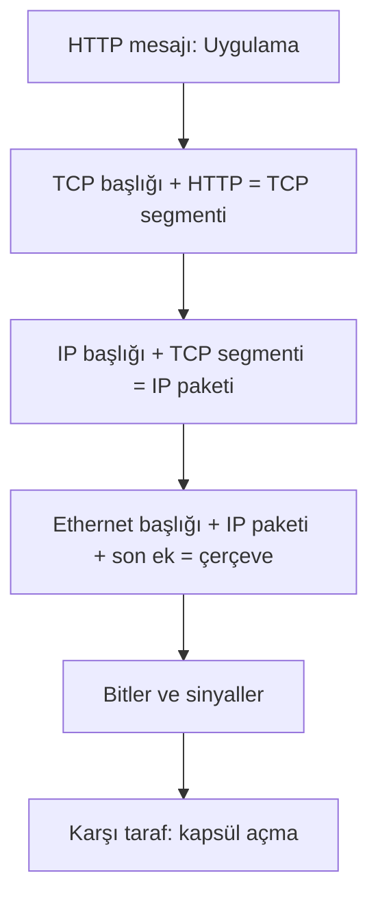

# Week 2 — Hedefli Tekrar ve Vize Hazırlığı

> [!abstract] Bu dosya ne işe yarar?
> Ders notlarının ikinci bir kopyası değildir. Week 2 boyunca **yanlış veya boş bıraktığın** kavramları hedefleyen bir vize çalışma paketi: kısa kurallar, çizimler, karşılaştırmalar, çözümlü örnekler, cevap anahtarlı mini sınavlar ve çalışma planı.

**Tam ders özeti:** [[Bilgisayar_Aglari_Week_2_Obsidian_Tum_Ders_Notlari]]  
**Week 1 temeli:** [[Bilgisayar_Aglari_Week_1_Obsidian_Ders_Notlari]]

## İçindekiler
- [[#1. Önceki bilgi kontrollerinin analizi]]
- [[#2. En kritik ezber kartları]]
- [[#3. OSI–TCP/IP–Hibrit–ATM modellerini sıfırdan ayırt et]]
- [[#4. Kapsülleme: aynı verinin katman katman yolculuğu]]
- [[#5. TCP/UDP/IP ve paket kaybı]]
- [[#6. Routing–forwarding, flow–congestion, delay–jitter]]
- [[#7. ATM: SVC/PVC, katmanlar, hesaplar]]
- [[#8. Ethernet–Wi-Fi: CSMA/CD, CSMA/CA ve gizli düğüm]]
- [[#9. Standartlar, ARPANET ve NSFNET hızlı tekrar]]
- [[#10. Çözümlü vize senaryoları]]
- [[#11. 5 oturumluk çalışma planı]]
- [[#12. Deneme sınavı — 100 puan]]
- [[#13. Cevap anahtarı ve puanlama]]
- [[#14. Aktif hatırlama kartları]]

---

## 1. Önceki bilgi kontrollerinin analizi

Aşağıdaki puanlar sohbet boyunca gerçekten **cevap verdiğin** ölçmelerin sonuçlarıdır; çok sayıda soruyu nokta ile boş bıraktığın için bunlar doğrudan konu hâkimiyeti yüzdesi değildir.

| Slayt aralığı | Puan / 10 | Gözlenen hata/eksik |
|---|---:|---|
| 9–12 | 5,5 | Ağ ve taşıma katmanları ters eşleştirildi; delay/jitter |
| 16–19 | 3 | Katmanların görevleri, IP bağlantısızlığı |
| 20–23 | 3,5 | TCP güvenilirliği ve kapsülleme; DNS'nin katmanı |
| 29–32 | 6 | IMP'nin teknik görevi; TCP/IP tekrarı |
| 33–35 | 7 | Routing/forwarding ayrıntısı; e-posta/haber grubu |
| 36–39 | 5 | SVC/PVC ve ATM katmanları; hesaplama iyi |
| 40–43 | 1 | Dört açık uçlu cevap boş, CSMA/CD doğru |
| 44–48 | 1 | Beş açık uçlu cevap boş, IEEE 802.11 doğru |
| Genel deneme | 6/100 | Yalnız 1–5 yanıtlandı; çoktan seçmeli 3/5 |

> [!warning] Öncelik sırası
> **P1:** IP–TCP–UDP ve katman farkları. **P2:** Kapsülleme ve TCP kayıp telafisi. **P3:** ATM katmanları ve sanal devreler. **P4:** Ethernet/Wi-Fi kontrol mekanizmaları. **P5:** ITU ve metrik birimler.

Öğrenme düzeyini değerlendirirken **boş sorulara sıfır verilmesini** yanıtlarda yanlış kavram bildiğinle eşdeğer sayma. Yeni testte mutlaka bütün soruları en azından kısa tanımla yanıtlamaya çalış.

## 2. En kritik ezber kartları

> [!tip] 15 saniyelik çekirdek
> **HTTP ister → TCP (gerekiyorsa) güvenilir taşır → IP yönlendirir → Ethernet çerçeveler → fiziksel katman sinyale dönüştürür.**

1. **OSI = 7**, **TCP/IP = 4**, **hibrit = 5**, **ATM = 3 ana katman**.
2. **Bit / çerçeve / paket** = fiziksel / veri bağlantı / ağ.
3. **IP = adresleme + yönlendirme, en iyi çaba, bağlantısız.**
4. **TCP = bağlantı odaklı, güvenilir, sıralı bayt akışı.**
5. **UDP = bağlantısız datagram, teslim/sıra garantisi yok.**
6. **Routing = yol bilgisini öğrenme/oluşturma.**
7. **Forwarding = gelen paketi uygun çıkışa gönderme.**
8. **Flow control = alıcı kapasitesi.**
9. **Congestion control = ağ yükü.**
10. **Delay = gecikme**, **jitter = gecikme değişkenliği**.
11. **ATM = 53 bayt = 5 başlık + 48 veri**.
12. **SAR = Segmentation and Reassembly (parçala/birleştir)**.
13. **CSMA/CD = eski ortak Ethernet**, **CSMA/CA = Wi-Fi**.
14. **IEEE 802.3 = Ethernet**, **802.11 = Wi-Fi**.
15. **ITU-R/T/D = Radyo / Standartlaşma / Geliştirme**.
16. **DNS de uygulama katmanında**; modem veya ana makine–ağ katmanında değil.
17. **1 B = 8 b**, **100 Mbps = 12,5 MB/s**, **1 Gbps bit süresi = 1 ns**.

> [!warning] Yanıltıcı genellemelere dikkat
> *“TCP güvenlik sağlar”* yanlış: TCP güvenilir iletim sağlar, şifreleme değildir. *“UDP her zaman daha hızlıdır”* yanlış: ek yükü daha düşüktür fakat performans duruma bağlıdır. *“IP rotayla ilgilenmez”* yanlış: yönlendirme IP katmanının merkezindedir. *“Forwarding gerektiğinde rotayı yeniden çizer”* yanlış: bu yönlendirme mekanizmalarının konusudur.

## 3. OSI–TCP/IP–Hibrit–ATM modellerini sıfırdan ayırt et

| İşlev | OSI (7) | TCP/IP (4) | Hibrit (5) |
|---|---|---|---|
| Uygulama | 7 Uygulama | Uygulama | Uygulama |
| Veri gösterimi | 6 Sunum | Uygulama içinde | Uygulama içinde |
| Oturum | 5 Oturum | Uygulama içinde | Uygulama içinde |
| Uçtan uca | 4 Taşıma | Taşıma | Taşıma |
| Ağlar arası | 3 Ağ | İnternet | Ağ |
| Çerçeve | 2 Veri bağlantı | Ana makine–ağ kapsamında | Veri bağlantı |
| Sinyal | 1 Fiziksel | Ana makine–ağ kapsamında | Fiziksel |

**ATM:** AAL (üst veri uyarlama), ATM (hücre/sanal devre), Fiziksel (iletişim ortamı).

### Kendi kendine sözlü sınav
- “Paket rotası hangi katmanda?” → **Ağ/İnternet**.
- “TCP segmenti kayboldu, kim yeniden iletebilir?” → **TCP (taşıma)**.
- “HTTP isteğini kim tanımlar?” → **HTTP (uygulama)**.
- “Bitlerin elektriksel gösterimi?” → **Fiziksel**.
- “Hatalı Ethernet çerçevesi kontrolü?” → **Veri bağlantı**.
- “DNS'yi nereye koyarsın?” → **Uygulama**.

**Ödev:** Bu tabloya bakmadan OSI'nin yedi katmanını, TCP/IP'nin dört katmanını ve hibrit modelin beş katmanını kâğıda çiz.

## 4. Kapsülleme: aynı verinin katman katman yolculuğu

Web tarayıcısı HTTP/1.1 üzerinden istek gönderiyor; bu örnek **TCP tabanlı HTTP** içindir (HTTP/3 başka bir taşıma biçimi kullanabilir).

**Bir yönlendiricide:** Gelen bağlantı katmanı çerçevesi işlenir, IP paketi hedefe göre yönlendirilir, sonraki bağlantıda yeni bir bağlantı katmanı çerçevesine yerleştirilebilir. Uçlardaki TCP bayt akışının güvenilirliğini ara yönlendiricinin temel forwarding işlevi sağlamaz.

### Ezber sorusu
**“Neden taşıma katmanı yönlendirme yapmaz?”** Çünkü taşıma katmanı **uç süreçler arası** hizmetle; IP ve yönlendiriciler **ağlar arası paket iletimiyle** ilgilenir.

### Tam puanlık 5 cümle
> Uygulama HTTP isteğini oluşturur. TCP, veriyi segmentlere bölebilir ve güvenilir sıralı bayt akışı sunar. IP, segmenti paket içinde hedefe doğru taşır. Ethernet, IP paketini yerel ağ çerçevesine yerleştirir. Fiziksel katman bitleri sinyaller üzerinden iletir; alıcıda ters yönde kapsül açma yapılır.

## 5. TCP/UDP/IP ve paket kaybı

### Üçlü karşılaştırma

| Özellik | TCP | UDP | IP |
|---|---|---|---|
| Katman | Taşıma | Taşıma | İnternet |
| Veri türü | Bayt akışı | Datagram | Paket |
| Bağlantı | Odaklı | Bağlantısız | Bağlantısız |
| Teslim garantisi | Sağlayabilir (bağlantı devam ederken) | Yok | Yok |
| Sıralı teslim | Evet | Hayır | Hayır |
| Yeniden iletim | Evet | Yerleşik değil | Yerleşik değil |
| Temel amaç | Uçtan uca güvenilir veri | Basit datagram iletimi | Ağlar arası iletim |

### TCP kaybı telafi etme adımları
1. Kaynak uygulama bayt akışını TCP'ye verir.
2. TCP veri için **bayt sıra numaraları** kullanır.
3. Alıcı **ACK** ile aldığını bildirir.
4. Eksik veri zaman aşımı veya uygun ACK örüntülerinden anlaşılır.
5. Gönderici eksik veriyi yeniden iletir.
6. Alıcı uygulamaya sıralı bayt akışı sunulur.

> [!warning] Teknik doğruluk
> “TCP kaybolan IP paketini geri getirir” yerine **“TCP kaybolan veriyi yeniden ileterek telafi etmeye çalışır”** yaz.

**UDP'de:** UDP'nin kendisinde ACK, yeniden iletim ve sıralı teslim garantisi yoktur; uygulama isterse ekler. “UDP her durumda daha hızlıdır” diye kesin hüküm kurma.

### 3 kısa soru
- TCP neden güvenilir? → Sıra numarası, ACK, yeniden iletim, uygun akış kontrolü.
- IP neden bağlantısız? → IP seviyesinde uçtan uca bağlantı kurma zorunluluğu yok; her paket bağımsız işlenir.
- TCP'de güvenlik var mı? → Tek başına şifreleme ve kimlik doğrulama sağlamaz.

## 6. Routing–forwarding, flow–congestion, delay–jitter

### 1. Routing ≠ Forwarding

| Routing | Forwarding |
|---|---|
| Yolların nasıl öğrenilip güncelleneceği | Paketin hangi çıkıştan gönderileceği |
| Kontrol düzlemiyle ilişkili | Veri düzlemiyle ilişkili |
| Statik veya dinamik olabilir | Güncel iletim bilgisine göre gerçekleşir |

**Senaryo:** Router R1, B ağına R2 üzerinden gidildiğini öğrenirse *routing*; paketi R2'ye gönderirse *forwarding*.

### 2. Akış kontrolü ≠ Tıkanıklık kontrolü

**Akış:** Gönderici 100 çerçeve/s, alıcı 60 çerçeve/s işliyor → alıcı tamponu dolar; gönderim penceresi gibi mekanizmalar gerekir.

**Tıkanıklık:** Router'a 180 Mbps geliyor, çıkış 100 Mbps → ağ kuyruğu büyür, paket kaybı olabilir; ağ trafik yükünün yönetimi gerekir.

### 3. Delay ≠ Jitter
- Delay: Bir paketin uçtan uca gecikmesi; işleme, kuyruk, iletim ve yayılma gecikmesi katkı yapabilir.
- Jitter: Paketin gecikmesinin paketler/zaman arasında değişmesi. Örn. 20, 21, 75, 22 ms gecikmelerde büyük değişkenlik vardır.
- Gerçek zamanlı ses/görüntü iletişiminde yüksek jitter takılma yaratabilir.

> [!question] Sınav senaryosu
> “Gönderici çok hızlı ama ağ boş” → **Akış kontrolü**. “Alıcı çok hızlı ama router kuyruğu dolu” → **Tıkanıklık kontrolü**. İkisi birlikte de görülebilir.

## 7. ATM: SVC/PVC, katmanlar, hesaplar

### Bilinmesi gereken sayı
**53 bayt = 5 bayt başlık + 48 bayt veri.**

### SVC ve PVC
- **SVC:** Trafik ihtiyacında bağlantı kurulur, sonra kaldırılır.
- **PVC:** Önceden yapılandırılmış sürekli kullanılabilir mantıksal devre.
- İkisi de tek bir özel fiziksel kablo anlamına gelmez.

### ATM katmanları

| Katman | Alt işlev | Hatırlama |
|---|---|---|
| AAL | CS | Üst veriyi uyarla |
| AAL | SAR | Böl / yeniden birleştir |
| ATM | Hücre, VPI/VCI, anahtarlama | Hücreyi ilet |
| Fiziksel | TC | Hücreyi iletim akışına yerleştir |
| Fiziksel | PMD | Sinyal, fiziksel ortam, bit zamanlaması |

### Çözümlü örnek 1: 960 bayt
$N=960/48=20$ hücre; toplam $20\times53=1060$ bayt; başlık $20\times5=100$ bayt; verimlilik $960/1060\times100\approx90{,}57\%$.

### Çözümlü örnek 2: 1.920 bayt
$N=1920/48=40$ hücre; toplam $40\times53=2120$ bayt; başlık $40\times5=200$ bayt; verimlilik $1920/2120\times100\approx90{,}57\%$.

### Çözümlü örnek 3: 100 bayt
İdeal hücreleme varsayımıyla $N=\lceil100/48
ceil=3$ hücre; hücre kapasitesi 144 B, dolgu 44 B, toplam 159 B, uygulama veri oranı $100/159\times100\approx62{,}89\%$. Gerçek AAL ek yükleri hesaba katılırsa farklılaşır.

**Önemli:** ATM sanal devresi hücre sırasını koruyabilir, **kayıpsız teslimatı garantilemez**; IP bağlantısız olduğundan paketler farklı yollar ve farklı sıralar izleyebilir.

## 8. Ethernet–Wi-Fi: CSMA/CD, CSMA/CA ve gizli düğüm

| Başlık | Klasik ortak Ethernet | IEEE 802.11 Wi-Fi |
|---|---|---|
| Kanal | Paylaşılan koaksiyel ortam | Paylaşılan radyo ortamı |
| Erişim yaklaşımı | **CSMA/CD** | **CSMA/CA** tabanlı yöntem |
| Çakışma | Algılanmaya çalışılır | Önlenmeye/azaltılmaya çalışılır |
| Modern nüans | Tam çift yönlü anahtarlamalı Ethernet'te CSMA/CD kullanılmaz | Gizli düğüm sorunu olabilir |

### Gizli düğüm
A, C'yi duyamaz; C de A'yı duyamaz; ikisi B'ye erişir. A ve C eşzamanlı iletim yaparsa B'de girişim oluşabilir. **RTS/CTS** gibi mekanizmalar uygun koşullarda yardımcı olabilir.

### Altyapılı ve ad hoc
- **Altyapılı:** Bir **AP** vardır; istemciler AP üzerinden veri alışverişi yapar.
- **Ad hoc:** Merkezî AP zorunlu değildir, cihazlar doğrudan haberleşir.
- **BSS:** Tek temel hizmet kümesi; **ESS:** Dağıtım sistemiyle birleştirilmiş BSS'ler; **roaming:** AP'ler arası geçiş.

### Çizim sorusu — cevap metni
> A ve C birbirini duymadığı için kanalı boş sanabilir ve aynı anda B'ye iletim yapabilir; gizli düğüm problemi oluşur. CSMA/CA rastgele bekleme/kanal algılama, gerekirse RTS/CTS ile çakışma olasılığını azaltır. Bu, çakışmasız iletişimi kesin garanti etmez.

## 9. Standartlar, ARPANET ve NSFNET hızlı tekrar

### IEEE ve ITU
- **802.3 Ethernet**, **802.11 Wi-Fi**; ilgili katmanlar fiziksel ve veri bağlantı.
- **ITU-R:** Radyo, frekans, uydu.
- **ITU-T:** Telekomünikasyon standardizasyonu.
- **ITU-D:** Gelişme, altyapı, erişim.
- **IETF:** İnternet protokol standartları.

### Tarihsel ağlar
- ARPANET 1969 dört kurumla çalıştı; **IMP** paket anahtarlama, **host** uç uygulama bilgisayarı.
- 1983 TCP/IP'ye geçiş.
- NSFNET akademik ağların/süper bilgisayar merkezlerinin bağlantısını güçlendirdi; ulusal omurga–bölgesel–kampüs modeli.
- İnternetin klasik dört kullanım alanı: **e-posta, haber grupları, uzak erişim, dosya aktarımı**.
- Web, internetin kendisi değil **internet üzerindeki bir hizmet**tir.

### Metrik birim formülleri
- $1\mathrm{B}=8\mathrm{b}$.
- $100\mathrm{Mbps}=12{,}5\mathrm{MB/s}$ (ek yük yok).
- $T_b=1/R_b$ ve 1 Gbps için $1\mathrm{ns}$.
- MB $=10^6$ B; MiB $=2^{20}$ B.

## 10. Çözümlü vize senaryoları

### Senaryo A — HTTP isteği
**Soru:** Ankara'daki istemci başka şehirdeki sunucuya web isteği gönderiyor. Protokollerin görevlerini açıkla.

**Cevap:** HTTP uygulama isteği oluşturur. TCP kullanılıyorsa güvenilir sıralı veri hizmeti sağlar. IP paket adresleme ve ağlar arası yönlendirmeye temel olur. Ethernet, yerel bağlantıdaki IP paketini çerçeveye kapsüller. Router'lar mevcut iletim bilgileriyle IP paketlerini sonraki bağlantılara gönderir. Hedefte kapsül açılır.

### Senaryo B — Kaybolan TCP verisi
**Soru:** Segment verisi yolda kayboldu.

**Cevap:** TCP sıra numarası/ACK ve zaman aşımı ya da uygun ACK örüntüleriyle kaybı anlayıp veriyi yeniden gönderebilir. IP paket teslimini garanti etmez. UDP kendiliğinden yeniden iletmez.

### Senaryo C — Gönderici hızlı, ağ yavaş
**Soru:** Gönderici 200 Mbps, ara çıkış 100 Mbps; alıcı tamponu da sınırlı.

**Cevap:** Çıkış bağlantısında tıkanıklık ve kuyruk problemi oluşabilir; *congestion control* gerekir. Alıcının tampon kapasitesi ayrıca *flow control* gerektirir. İki mekanizma birbirinden farklı problemlere yöneliktir.

### Senaryo D — Üniversite Wi-Fi ağında kullanıcı hareket ediyor
**Soru:** Bir AP'nin kapsamasından ötekine geçiyor.

**Cevap:** Birden fazla BSS uygun dağıtım sistemi üzerinden ESS oluşturabilir. İstemcinin AP değiştirmesi *roaming*dir; kesintisizlik ve otomatik geçişin başarısı yapılandırmaya bağlıdır.

### Senaryo E — ATM 100 bayt
**Soru:** 48 bayt yük taşıyan 53 baytlık hücrelerle 100 bayt gönder; salt hücre düzeyinde oranı bul.

**Cevap:** 3 hücre = 159 bayt, 15 B başlık, 44 B boş kapasite; 100/159 = **%62,89** yararlı uygulama verisi oranı. Adaptasyon ek yükü yok sayılmıştır.

## 11. 5 oturumluk çalışma planı

> [!success] Uygulama kuralı
> Her oturumun başında konuyu **notlara bakmadan iki dakika** açıkla. Ardından notlarla karşılaştır ve mutlaka kendi cümlelerinle bir soru çöz.

- [ ] **Oturum 1 — 50 dk: OSI/TCP-IP/hibrit.** Üç modeli çiz; protokol katmanlarını eşleştir; [[#4. Kapsülleme: aynı verinin katman katman yolculuğu]] bölümünü ezbere açıklayarak bitir.
- [ ] **Oturum 2 — 55 dk: TCP/UDP/IP.** Kayıp veri ve ACK örneği; routing/forwarding, flow/congestion, delay/jitter üçlü karşılaştırması.
- [ ] **Oturum 3 — 35 dk: ATM.** AAL/SAR/CS/ATM/TC/PMD; SVC/PVC; üç hücre hesaplaması.
- [ ] **Oturum 4 — 35 dk: Ethernet/Wi-Fi.** CSMA/CD ve CSMA/CA; gizli düğüm, ad hoc, BSS/ESS, roaming.
- [ ] **Oturum 5 — 50 dk: Standartlar + tam deneme.** ITU, IEEE, NSFNET/ARPANET; ardından aşağıdaki 100 puanlık sınavı çöz.

**Önerilen toplam süre:** 225 dakika = **3 saat 45 dakika** (mola hariç). Planı iki veya üç güne bölebilirsin.

**Hedef:** Çoktan seçmeli 10/10, kısa cevap en az 30/40, analiz bölümü en az 35/50.

## 12. Deneme sınavı — 100 puan

> [!question] Talimatlar
> 90 dakika. İlk beş soru 2'şer puan (10 p.), 6–13 soruları 5'er puan (40 p.), 14–18 soruları 10'ar puan (50 p.). **Önce cevapla; sonra [[#13. Cevap anahtarı ve puanlama]] bölümünü aç.**

### A Bölümü — 5 × 2 = 10 puan

**1.** OSI'de paket yönlendirme temel olarak hangi katmandadır? A) Taşıma B) Ağ C) Sunum D) Oturum

**2.** TCP için hangisi doğrudur? A) Bağlantısız datagram B) IP routing tablosu oluşturur C) Güvenilir sıralı bayt akışı D) Fiziksel bağlantıyı yönetir

**3.** Hatalı eşleştirme hangisi? A) 802.3–Ethernet B) 802.11–Wi-Fi C) DNS–Uygulama D) HTTP–Fiziksel

**4.** ATM hücresi biçimi? A) 5+48 B) 48+5 C) 20+33 D) 8+45 bayt

**5.** Wi-Fi'de çakışma olasılığını azaltan yöntem? A) CSMA/CD B) CSMA/CA C) SMTP D) IP parçalama

### B Bölümü — 8 × 5 = 40 puan

**6.** OSI'nin yedi katmanını üstten alta yaz, her birini tek cümleyle açıkla.

**7.** TCP/IP'nin dört ve hibrit modelin beş katmanını yaz; OSI oturum/sunum katmanlarının TCP/IP'deki durumunu açıkla.

**8.** Hizmet, arayüz ve protokol farkını TCP örneğiyle açıkla.

**9.** Routing/forwarding ile statik/dinamik yönlendirme farkını açıkla.

**10.** TCP/UDP'yi bağlantı, sıralama, yeniden iletim, akış kontrolü açısından karşılaştır. Güvenilirlik–güvenlik ayrımını açıkla.

**11.** ARPANET'te host ve IMP farkı nedir? NSFNET'in temel amacı neydi?

**12.** ATM'nin üç katmanını, AAL/SAR/TC/PMD görevlerini ve SVC/PVC farkını açıkla.

**13.** ITU-R/T/D görevleri; 802.3 ve 802.11 eşleştirmeleri.

### C Bölümü — 5 × 10 = 50 puan

**14.** TCP üzerinden HTTP isteğinin kapsülleme yolculuğunu anlat; TCP, IP, Ethernet, ISP ve router rollerini belirt.

**15.** TCP segmentinin verisi kaybolduğunda sıra numarası, ACK, yeniden iletim ve sıralı teslim nasıl çalışır? UDP ile farkı nedir?

**16.** Giriş 200 Mbps, çıkış 100 Mbps ve alıcı tamponu sınırlı: flow/congestion, delay/jitter kavramlarıyla açıkla.

**17.** A ve C birbirini duymuyor, B'ye gönderebiliyor: hidden terminal, CSMA/CA, RTS/CTS, BSS/ESS/roaming, ad hoc ve CSMA/CD farkı.

**18.** ATM ile 1.920 bayt veri: hücre sayısı, başlık, toplam boyut, verimlilik; bağlantılı ATM ve bağlantısız IP karşılaştırması.

---

## 13. Cevap anahtarı ve puanlama

> [!warning] Önce denemeyi çöz
> Bu bölümü sınav sırasında kapalı tut. Açık uçlu sorularda yalnız sonuç değil, **mekanizma ve teknik gerekçe** yazmaya çalış.

### A bölümü
**1 B, 2 C, 3 D, 4 A, 5 B**. Her biri 2 puan.

### B bölümü — Beklenen unsurlar (her biri 5 puan)
**6:** OSI 7 sıra: Uygulama/sunum/oturum/taşıma/ağ/veri bağlantı/fiziksel; temel görevleri doğru.

**7:** TCP/IP 4: uygulama/taşıma/internet/ana makine–ağ. Hibrit 5: uygulama/taşıma/ağ/veri bağlantı/fiziksel. Oturum/sunum, TCP/IP'de bağımsız katman değil.

**8:** Hizmet=ne, arayüz=nasıl erişim, protokol=eşlerin kuralları; TCP hizmeti/soket/TCP ACK örneği.

**9:** Routing yol bilgisini öğrenir/günceller; forwarding paketi çıkışa taşır; statik yönetici tanımı, dinamik protokolle güncelleme.

**10:** TCP bağlantılı/güvenilir/sıralı/yeniden iletim/akış; UDP bağlantısız/datagram/garantisiz/yerleşik yeniden iletim yok; güvenilirlik şifreleme değildir.

**11:** Host uç uygulama bilgisayarı, IMP paket anahtarı; NSFNET akademik/süper bilgisayar erişimi için omurga.

**12:** AAL/ATM/fiziksel; SAR böl–birleştir, TC hücre akışı, PMD sinyal/bit, CS uyarlama; SVC ihtiyaçta, PVC önceden kurulu.

**13:** ITU-R radyo, T standartlaştırma, D gelişim; IEEE 802.3 Ethernet, 802.11 WLAN.

### C bölümü — Beklenen unsurlar (her biri 10 puan)
**14:** HTTP → TCP segment → IP paket → Ethernet çerçeve → sinyal. ISP/erişim/ara router üzerinden IP forwarding; hedefte decapsulation.

**15:** TCP bayt sıra numarası, ACK, zaman aşımı/yinelenen ACK ile kayıp algılama, yeniden iletim, sıralı byte stream; UDP'de kendiliğinden yok.

**16:** 200>100 Mbps tıkanıklık/kuyruk; alıcı tamponu akış kontrolü; delay toplam gecikme, jitter gecikme değişkenliği.

**17:** A/C gizli düğüm, B'de çakışma; CSMA/CA ve gerektiğinde RTS/CTS; altyapılı/AP, ad hoc/AP yok, BSS/ESS/roaming; CSMA/CD klasik ortak Ethernet.

**18:** $1920/48=40$ hücre; $40\times5=200$ B başlık; $40\times53=2120$ B toplam; $1920/2120\times100\approx90{,}57\%$; ATM sanal devreli, IP bağlantısız en iyi çaba.

> [!tip] Öz puanlama
> 5 puanlık cevapta **tanım 2 + mekanizma 2 + doğru örnek 1**; 10 puanlık cevapta **doğru model/terim 3 + mekanizma 4 + senaryoya uygulama 3** şeklinde çalışabilirsin. Bu notlandırma resmî üniversite rubriği değildir.

## 14. Aktif hatırlama kartları

Obsidian'da her kartın sorusuna yanıtı gizleyerek çalışabilirsin.

> [!question]- Kart 1 — Ağ katmanı ile taşıma katmanı farkı?
> Ağ katmanı IP paketlerini yönlendirir; taşıma katmanı uç süreçler arasında taşıma hizmeti verir.

> [!question]- Kart 2 — DNS hangi katmandadır?
> Uygulama.

> [!question]- Kart 3 — TCP güvenliği mi güvenilirliği mi sağlar?
> Güvenilir sıralı bayt akışı; kendisi şifreleme sağlamaz.

> [!question]- Kart 4 — Forwarding rota değiştirmek midir?
> Hayır; mevcut iletim bilgisine göre gelen paketi uygun çıkışa aktarmaktır.

> [!question]- Kart 5 — Flow ve congestion farkı?
> Alıcı kapasitesi ile ağ kaynaklarının aşırı yüklenmesi.

> [!question]- Kart 6 — Bir ATM hücresi?
> 53 B = 5 başlık + 48 veri.

> [!question]- Kart 7 — SVC ve PVC?
> İhtiyaç halinde kurulan ve önceden kalıcı yapılandırılan sanal devre.

> [!question]- Kart 8 — SAR ve PMD?
> SAR böl ve birleştir; PMD fiziksel sinyal ve bit zamanlaması.

> [!question]- Kart 9 — CSMA/CD ve CSMA/CA?
> Paylaşımlı Ethernet çakışma algılama / Wi-Fi çakışmadan kaçınma.

> [!question]- Kart 10 — BSS, ESS, roaming?
> Temel hizmet kümesi / birleştirilmiş BSS'ler / AP'ler arasında dolaşım.

> [!question]- Kart 11 — ARPANET'teki IMP ve Host?
> IMP paket anahtarlama; Host veri üreten/tüketen uç sistem.

> [!question]- Kart 12 — ISO, IEEE, ITU, IETF farkı?
> ISO genel uluslararası standart; IEEE ağ/elektrik-elektronik; ITU telekomünikasyon; IETF internet protokolleri.

> [!question]- Kart 13 — Gecikme mi jitter mı?
> Gecikme paket süresi, jitter gecikmeler arasındaki değişkenlik.

> [!question]- Kart 14 — 1 Gbps'de bit süresi?
> 1 nanosaniye.

> [!question]- Kart 15 — İnternetin tarihsel dört kullanımı?
> E-posta, haber grupları, uzaktan erişim, dosya aktarımı.

---

## Son kontrol listesi
- [ ] OSI–TCP/IP–hibrit modellerini **bakarak değil ezberden** çiziyorum.
- [ ] HTTP/TCP/UDP/IP/DNS/Ethernet katmanlarını doğru eşliyorum.
- [ ] TCP kaybı nasıl telafi eder, örnekle anlatabiliyorum.
- [ ] Routing–forwarding ve flow–congestion farkını biliyorum.
- [ ] ATM katmanlarını ve 53 bayt hesaplarını yapabiliyorum.
- [ ] CSMA/CD–CSMA/CA ve gizli düğümü açıklıyorum.
- [ ] BSS/ESS/roaming, ITU ve IEEE 802 eşleştirmelerini biliyorum.
- [ ] [[#12. Deneme sınavı — 100 puan]] sorularının tamamını cevaplıyorum.

