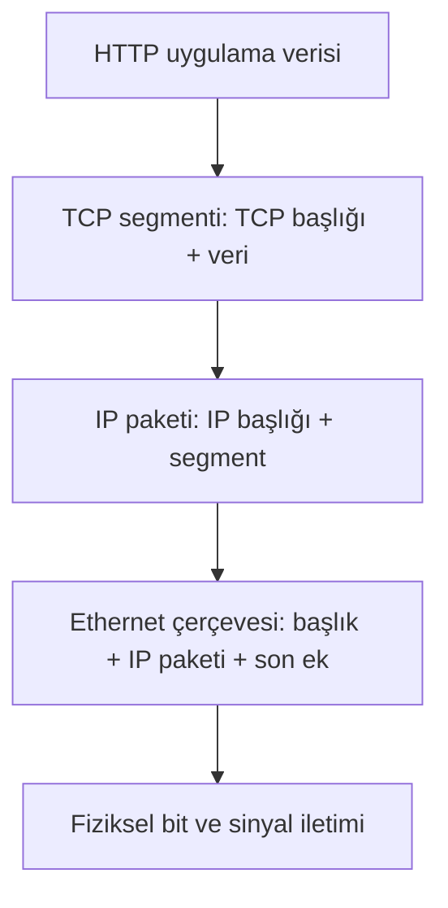

# Bilgisayar Ağları ve Veri İletişimi — Week 2

> [!abstract] Bu notun amacı
> Week 2 boyunca çalıştığımız **48 slaydın** konularını, kavramlarını, sınıfta/sınavda kullanılabilecek tanımları ve örnekleri tek yerde tutmaktır. Slayt numaraları, konuşmanın sonunda düzeltilmiş **48 slaytlık** sunum sırasına göre verilmiştir. Teknik karşılaştırmalarda tarihsel model ile modern uygulama ayrımları özellikle belirtilmiştir.

> [!info] Kaynak ve kapsam
> Ankara Üniversitesi Bilgisayar Ağları ve Veri İletişimi Week 2 sunumu: https://android.eng.ankara.edu.tr/wp-content/uploads/sites/656/2017/09/Week_2.pdf  
> Temel kitap: Andrew S. Tanenbaum, *Computer Networks*, 4. baskı, Bölüm 1. Bu dosya, ders sırasında birlikte oluşturduğumuz anlatımların **derlenmiş çalışma notudur**, orijinal PDF'nin birebir çevirisi değildir. Bazı slaytların çevrimiçi erişimi dönemsel olarak sorunlu olduğundan, konu sıralaması önceki incelemelerde karşılaştırılan baskıyla uyarlanmıştır.

## İçindekiler
- [[#1. Başlangıç ve referans modelleri — Slayt 1–4]]
- [[#2. OSI fiziksel ve veri bağlantı katmanı — Slayt 5–8]]
- [[#3. OSI ağ ve taşıma katmanı — Slayt 9–12]]
- [[#4. OSI oturum, sunum ve uygulama katmanı — Slayt 13–15]]
- [[#5. TCP/IP modelinin katmanları — Slayt 16–23]]
- [[#6. OSI–TCP/IP karşılaştırması ve hibrit model — Slayt 24–28]]
- [[#7. Örnek ağlar ve ARPANET — Slayt 29–32]]
- [[#8. NSFNET ve internet mimarisi — Slayt 33–35]]
- [[#9. ATM sanal devre, hücre ve katmanları — Slayt 36–40]]
- [[#10. Ethernet ve kablosuz LAN — Slayt 41–44]]
- [[#11. Ağ standartlaştırması — Slayt 45–47]]
- [[#12. Metrik birimler — Slayt 48]]
- [[#13. Birleşik karşılaştırma tabloları]]
- [[#14. Week 2 kısa cevaplı soru bankası]]

---

## 1. Başlangıç ve referans modelleri — Slayt 1–4

### Slayt 1 — Chapter 1: Introduction (devam)
Week 1'de öğrenilen **katman**, **hizmet**, **arayüz** ve **protokol** kavramları gerçek ağ mimarilerinde kullanılır. Alt katmanlar üst katmanlara hizmet sunar; farklı makinelerdeki eş katmanlar ise protokollere göre mantıksal haberleşir.

### Slayt 2 — Referans modelleri (Reference Models)
- **OSI:** Genel kavramsal yedi katmanlı model.
- **TCP/IP:** İnternet protokollerini açıklayan klasik dört katmanlı model.
- İki modelin ortaklıkları, farkları ve eleştirileri incelenir.
- Referans model bir *kavramsal yapı*; TCP, IP, HTTP ise *somut protokol örnekleri*dir.

### Slayt 3 — OSI referans modeli (OSI Reference Model)

| Sıra | Katman | İngilizcesi | Ana işlev |
|---:|---|---|---|
| 7 | Uygulama | Application | Uygulamalara ağ hizmeti |
| 6 | Sunum | Presentation | Sözdizimi, anlam, veri gösterimi |
| 5 | Oturum | Session | Diyalog, jeton, eşzamanlama |
| 4 | Taşıma | Transport | Uçtan uca taşıma hizmeti |
| 3 | Ağ | Network | Paket adresleme ve yönlendirme |
| 2 | Veri bağlantı | Data Link | Çerçeve iletimi, yerel bağlantı kontrolü |
| 1 | Fiziksel | Physical | Bitlerin sinyal olarak iletimi |

**PDU (Protocol Data Unit):** Bir katmanda işlenen protokol veri birimidir. Klasik çizimde sırasıyla APDU, PPDU, SPDU, TPDU, **paket**, **çerçeve**, **bit** isimleri görünür. Pratikte TCP için segment, UDP için datagram da denir.

**Uç sistem–yönlendirici:** Kaynak ve hedef host uygulama/taşıma işlevlerini de kullanabilir; yönlendiricinin temel IP yönlendirme işlemi başlıca ağ, veri bağlantı ve fiziksel katmanlardadır. Modern yönlendiricilerin yönetim gibi üst katman işlevleri de olabilir.

### Slayt 4 — OSI'nin beş tasarım ilkesi
1. Farklı soyutlama gerekiyorsa ayrı katman oluştur.
2. Her katmana belirli, açık bir işlev ver.
3. İşlevleri uluslararası standartlaşmaya elverişli seç.
4. Katman arayüzlerinde gereksiz bilgi aktarımını en aza indir.
5. Katman sayısını ne çok az ne gereksiz fazla tut.

> [!tip] Tam puanlık kısa cevap
> OSI, iletişim işlevlerini iyi tanımlanmış katmanlara ayırır; soyutlama, standartlaşma, az bağımlılık ve dengeli katman sayısı ilkesini benimser.

## 2. OSI fiziksel ve veri bağlantı katmanı — Slayt 5–8

### Slayt 5 — Fiziksel katman I (Physical Layer)
- **Ham bitlerin** fiziksel kanaldan taşınmasından sorumludur.
- 0 ve 1'in hangi fiziksel sinyal seviyeleriyle temsil edileceğini belirler.
- Bit süresi, iletim zamanlaması ve tek/çift yönlü iletişim gibi hususları kapsar.
- Sinyal: bakırda elektriksel, fiberde optik, kablosuzda elektromanyetik olabilir.

**Bit süresi:** Sabit bit hızında $T_b=1/R_b$. Örnek: 100 Mbps'de $T_b=1/(100\times10^6)=10$ nanosaniye.

**İletim yönleri:** Tek yönlü (*simplex*), iki yönde sırayla (*half-duplex*), iki yönde eşzamanlı (*full-duplex*).

### Slayt 6 — Fiziksel katman II
- **Mekanik:** Konektör, pin, bağlantı biçimi.
- **Elektriksel:** Sinyal seviyeleri ve elektriksel özellikler.
- **Zamanlama:** Sinyal/bit başlangıcı ve bit sürelerinin algılanması.
- Fiziksel bağlantı etkinleştirme/sonlandırma ile **TCP bağlantı kurulumu aynı şey değildir**.
- İletim ortamı: bakır, fiber, radyo vb.

### Slayt 7 — Veri bağlantı katmanı I (Data Link Layer)
Fiziksel bit akışını **çerçevelere (frame)** düzenler. Çerçeve sınırları belirlenebilir; başlık (header), veri (payload), bazı protokollerde son ek (trailer) bulunabilir. Çerçevelerde adresleme ve hata tespiti için kontrol alanları kullanılabilir.

- **Framing:** Veri birimi başlangıcı ve sonunu tanıma.
- **Error detection:** Örneğin CRC ile bozulmayı tespit etme.
- **ACK (Acknowledgement):** Bazı *güvenilir bağlantı* hizmetlerinde doğru alındı onayı.
- Her veri bağlantı protokolü ACK göndermez; klasik Ethernet her başarılı çerçeve için bağlantı katmanı ACK vermez.

### Slayt 8 — Veri bağlantı katmanı II
- **Akış kontrolü (Flow Control):** Göndericinin alıcının işleme/tampon kapasitesini aşmamasını sağlamak.
- **Ortam erişim kontrolü (MAC):** Paylaşılan kanala hangi cihazın ne zaman erişeceğini düzenlemek.
- **MAC alt katmanı ≠ MAC adresi.** Birincisi kontrol işlevleri, ikincisi bağlantı katmanı adreslemesinde kullanılan tanımlayıcıdır.

| Kavram | Sorusu |
|---|---|
| Hata kontrolü | Veri bozuldu mu, kayıp oldu mu? |
| Akış kontrolü | Alıcı veriyi yetiştirebiliyor mu? |
| Ortam erişim kontrolü | Ortak ortamı hangi cihaz ne zaman kullanacak? |

> [!warning] Kritik ayrım
> Fiziksel = **bit**. Veri bağlantı = **çerçeve**. Ağ = **paket**.

## 3. OSI ağ ve taşıma katmanı — Slayt 9–12

### Slayt 9 — Ağ katmanı I (Network Layer)
- Farklı ağlar üzerinde paketin kaynak–hedef arasındaki iletimi.
- **Routing:** Yol bilgilerinin hesaplanması/öğrenilmesi ve güncellenmesi.
- **Forwarding:** Mevcut iletim tablosuyla paketin uygun çıkışa aktarılması.
- **Statik yönlendirme:** Önceden yapılandırılmış yollar; genelde yönetici müdahalesi gerekir.
- **Dinamik yönlendirme:** Ağ durumu ve bağlantı değişimlerine protokol yardımıyla uyum sağlar.
- Bağlantı odaklı bazı ağlarda iletişim başlangıcında yol seçilebilir. IP'de her paket için tablonun baştan hesaplanması zorunlu değildir.

### Slayt 10 — Ağ katmanı II
- **Ağ tıkanıklığı (Congestion):** Trafik ağ kapasitesini aştığında kuyruk, gecikme ve paket kaybı oluşabilir.
- **Hizmet kalitesi (QoS):** Gecikme, gecikme değişkenliği (*jitter*), kapasite vb. gereksinimler.
- Farklı ağların paket boyutu, adresleme veya teknoloji farklılıklarına rağmen birlikte çalışması.
- Yerel yayın ortamında her teslim için çok atlamalı yol gerekmeyebilir; bunun anlamı ağ katmanı tamamen yoktur değildir.

**Flow vs congestion:** Flow alıcı kapasitesi; congestion ağın toplam yükü ve kaynakları.

**Delay vs jitter:** Gecikme, paketin iletilmesi için geçen süre; jitter, paket gecikmelerinin değişkenliğidir.

### Slayt 11 — Taşıma katmanı I (Transport Layer)
- Kaynak ve hedef uç sistemlerdeki süreçlere **uçtan uca (end-to-end)** iletişim hizmeti sunar.
- Uygulama verisini gerektiğinde segmentlere/birimlere ayırabilir.
- Kullanılan protokole göre güvenilirlik, sıralama, hata telafisi ve akış kontrolü sunulabilir.
- Üst katmanları alttaki ağ teknolojisinin ayrıntılarından soyutlar.
- **TCP güvenilir bayt akışıdır; UDP garantisiz datagram hizmetidir.** Her taşıma protokolü güvenilir değildir.

### Slayt 12 — Taşıma katmanı II
- TCP'nin sıra numarası, ACK ve yeniden iletim mekanizmaları ile sıralı teslimat sağlaması.
- Uçtan uca iletişim, aradaki fiziksel bağlantılardan farklıdır: Host A–Host B arasında birçok router olabilir.
- TCP/IP ağlarında **IP adresi hedef sistemi / arayüzü**, **port numarası ilgili iletişim uç noktasını** belirlemeye yardım eder.
- **IP yönlendirir; TCP güvenilir uçtan uca taşıma hizmeti sunabilir.**

> [!example] Bir dosya gönderme
> Uygulama 12.000 bayt veri üretir. TCP gerektiğinde bayt akışını segmentlere ayırır. IP segmentleri paketlerle ağlardan geçirir. Router'lar IP paketlerini iletir. Alıcı TCP veriyi doğru sırada uygulamaya sunar. IP parçalanması farklı bir mekanizmadır; bu örnekteki TCP segmentasyonu ile karıştırılmamalıdır.

## 4. OSI oturum, sunum ve uygulama katmanı — Slayt 13–15

### Slayt 13 — Oturum katmanı (Session)
1. **Diyalog kontrolü:** İki tarafın konuşma sırası ve iletişim yönünü düzenlemek.
2. **Jeton yönetimi (Token Management):** Bazı işlemlerde tek tarafın hak sahibi olmasını sağlamak; güvenlik erişim token'ıyla aynı şey değildir.
3. **Eşzamanlama (Synchronization):** Uzun işlemlere kontrol noktaları koyup kesinti sonrası uygun yerden sürdürmeye yardım etmek.

Örnek: Büyük dosya aktarımının kontrol noktasından sürdürülmesi kavramsal bir oturum hizmetidir; her dosya protokolünde kendiliğinden bulunmaz.

### Slayt 14 — Sunum katmanı (Presentation)
- Bilginin **sözdizimi (syntax)** ve **anlamı (semantics)**.
- Karakter kodlama ve veri temsili, bayt sırası (*big-/little-endian*) gibi biçim farkları.
- Şifreleme ve sıkıştırma bazı OSI sunum katmanı anlatımlarında örnektir; gerçek TCP/IP'de ayrı bir sunum katmanı olmak zorunda değildir.
- JSON örneği gösterim açısından açıklayıcıdır ancak pratikte çoğunlukla uygulama yazılımları işler.

### Slayt 15 — Uygulama katmanı (Application)
- Uygulamalara ağ iletişim hizmetlerini sağlayan üst seviye protokoller: **HTTP, SMTP, FTP, DNS, SSH**.
- Uygulamanın ekran arayüzü ≠ uygulama katmanı protokolü.
- HTTP web istek/yanıt kurallarını, SMTP e-posta gönderimini, FTP dosya aktarımını, DNS alan adı kayıtlarının çözümlemesini tanımlar.
- Web'i internetin kendisi sanma: WWW, internet üzerinde çalışan hizmetlerden biridir.

## 5. TCP/IP modelinin katmanları — Slayt 16–23

> [!warning] Numara düzeltmesi
> Çalışma sohbetinde ilk anlatımda slayt 17–21 konuları bir miktar kaymıştı. Düzeltilen sıra: **16 giriş; 17 internet; 18–19 taşıma; 20 uygulama; 21 ana makine–ağ; 22–23 protokol ve model şekilleri.** Konuların tamamı aşağıda bu sırada listelenmiştir.

### Slayt 16 — TCP/IP'ye giriş
ARPANET araştırma ağı ve farklı ağları birbirine bağlama ihtiyacı TCP/IP mimarisinin gelişiminde etkili oldu. Klasik TCP/IP modeli **4 katman** içerir. TCP = Transmission Control Protocol, IP = Internet Protocol; aynı katmanda değillerdir.

### Slayt 17 — İnternet katmanı (Internet Layer)
- Temel protokol **IP**.
- Paket anahtarlamalı, bağlantısız (connectionless), **en iyi çaba (best effort)** iletim.
- Her IP paketi hedef adresiyle bağımsız iletilebilir; paketler kaybolabilir, farklı yoldan gidebilir, farklı sıralarda gelebilir.
- IP teslimat, sıralama ve otomatik yeniden iletim garantisi vermez.
- **Bağlantısız = yollarla ilgilenmiyor** demek değildir: Router'lar hedefe göre iletir.

### Slayt 18–19 — Taşıma katmanı (Transport Layer)
**TCP:** Bağlantı odaklı; güvenilir sıralı *bayt akışı*; sıra numaraları, ACK, kayıp tespiti, yeniden iletim, akış ve tıkanıklık kontrolü.

**UDP:** Bağlantısız *datagram*; sıra ve teslim garantisi yok; kendi başına yeniden iletim/akış kontrolü sunmaz; sekiz baytlık başlık kullanır. Uygulama kendi güvenilirlik özelliklerini ekleyebilir (ör. UDP üstünde QUIC).

| Özellik | TCP | UDP |
|---|---|---|
| İletim biçimi | Bayt akışı | Datagram |
| Bağlantı | Bağlantı odaklı | Bağlantısız |
| Güvenilir, sıralı teslim | Evet (bağlantı sağlıklıysa) | Garanti yok |
| Yeniden iletim | Var | Yerleşik değil |
| Akış / tıkanıklık kontrolü | Var | Yerleşik değil |
| Minimum başlık | 20 B | 8 B |

> [!warning] Güvenilirlik ≠ güvenlik
> TCP'nin güvenilirliği veri bütünlüğü ve sıralı teslimat anlamındadır; otomatik **şifreleme** veya gizlilik sağlamaz.

### Slayt 20 — Uygulama katmanı
HTTP, FTP, SMTP, DNS, TELNET gibi üst düzey protokoller. Klasik TCP/IP'de OSI'nin ayrı oturum ve sunum katmanları yoktur; gerekli işlevler uygulama yazılımlarında gerçekleştirilebilir.

### Slayt 21 — Ana makine–ağ katmanı (Host-to-Network)
- Host'un bulunduğu fiziksel/veri bağlantı ağına erişimi.
- Klasik TCP/IP modelinde Ethernet/Wi-Fi gibi alt ağ teknolojilerinin tüm ayrıntıları tanımlanmaz.
- Farklı yerel ağlar üzerinde aynı IP mimarisi kullanılabilir.

### Slayt 22–23 — Model ve protokollerinin şemaları

| TCP/IP üstten alta | Örnek |
|---|---|
| Uygulama | HTTP, DNS, SMTP, FTP |
| Taşıma | TCP, UDP |
| İnternet | IP |
| Ana makine–ağ | Ethernet, Wi-Fi gibi erişim teknolojileri |

**Kapsülleme (Encapsulation):** HTTP mesajı → TCP segmenti → IP paketi → Ethernet çerçevesi → fiziksel sinyal. Alıcıda ilgili katmanlarda *kapsül açma (decapsulation)* yapılır.

> [!tip] Kısa ezber
> **HTTP ister — TCP güvenilir taşır — IP yönlendirir — Ethernet çerçeveler — fiziksel katman sinyale dönüştürür.**

## 6. OSI–TCP/IP karşılaştırması ve hibrit model — Slayt 24–28

### Slayt 24 — Hizmet, arayüz, protokol ayrımı
- **Hizmet (Service):** Üst katmana *ne sunuluyor?* Örn. güvenilir bayt akışı.
- **Arayüz (Interface):** Hizmete *nasıl erişilir?* Örn. soket arayüzü.
- **Protokol (Protocol):** Eş katmanlar *hangi kurallarla haberleşir?* Örn. TCP sıra numarası/ACK.
OSI bu ayrımı sistematik yapar. Klasik TCP/IP modeli mevcut protokoller etrafında şekillenmiştir.

### Slayt 25 — OSI'nin eleştirileri
Tarihsel OSI protokollerinin TCP/IP karşısında benimsenmesini sınırlayan dört temel nokta:
1. **Bad Timing — Yanlış zamanlama:** TCP/IP daha önce pratik kullanım kazandı.
2. **Bad Technology — Tasarım karmaşıklığı:** Ağır, gereksiz tekrar içeren işlevler.
3. **Bad Implementations — Zayıf ilk uygulamalar:** Performans/karmaşıklık sorunları.
4. **Bad Politics — Kurumsal çekişmeler:** Farklı standart ve yatırım tercihleri.
**OSI kavramsal modeli hâlâ öğretimde yararlıdır; eleştiriler OSI protokol ailesinin yaygınlaşmasına yöneliktir.**

### Slayt 26 — İki fil eğrisi (Bad Timing)
Teknoloji araştırmalarının yoğun olduğu ilk dönem ile yatırım/uygulama patlamasının yaşandığı sonraki dönem arasında bir standartlaştırma penceresi bulunabilir. OSI standartlarının olgunlaşması, TCP/IP'nin yaygınlaştığı döneme denk geldi. Teknik yeterlilik yanında **zamanlama ve benimsenme** de önemlidir.

### Slayt 27 — TCP/IP modelinin beş eleştirisi
1. Hizmet, arayüz ve protokol ayrımı OSI kadar net değil.
2. Bütün protokol aileleri için genel amaçlı model değil.
3. Ana makine–ağ katmanı ayrıntılı tanımlanmamış.
4. Fiziksel ve veri bağlantı katmanı kavramsal olarak ayrılmamış.
5. Tarihsel olarak kökleşen bazı protokolleri değiştirmek güç.

### Slayt 28 — Hibrit model (Hybrid Model)
**5 katman:** Uygulama → Taşıma → Ağ → Veri bağlantı → Fiziksel. OSI'nin ayrı sunum ve oturum katmanları yok; TCP/IP'nin alt katman belirsizliği giderilmiş.

| OSI: 7 | TCP/IP: 4 | Hibrit: 5 |
|---|---|---|
| Uygulama | Uygulama | Uygulama |
| Sunum | Uygulama kapsamında | Uygulama kapsamında |
| Oturum | Uygulama kapsamında | Uygulama kapsamında |
| Taşıma | Taşıma | Taşıma |
| Ağ | İnternet | Ağ |
| Veri bağlantı | Ana makine–ağ | Veri bağlantı |
| Fiziksel | Ana makine–ağ | Fiziksel |

> [!tip] Üç sayı
> **OSI 7 — TCP/IP 4 — Hibrit 5.**

## 7. Örnek ağlar ve ARPANET — Slayt 29–32

### Slayt 29 — Örnek ağlar (Example Networks)
İnternet, bağlantı odaklı X.25/Frame Relay/ATM, Ethernet ve IEEE 802.11 gibi kablosuz LAN örnekleri. **İnternet** bir ağlar ağıdır; **ARPANET** onun tarihsel öncüllerinden biridir.

### Slayt 30 — ARPANET'in ortaya çıkışı, hiyerarşik/dağıtık tasarım
- Geleneksel telefon ağlarının hiyerarşik anahtarlama merkezleri, kritik üst düğümlerde arızaya karşı hassas olabilir.
- Paul Baran'ın dağıtık anahtarlama fikrinde alternatif yollar, uygun yedeklilikle arıza dayanıklılığını artırabilir.
- **Dağıtık ağ topolojisi** ile **dağıtık sistem** (birçok bilgisayarın bütünleşik bir sistem gibi görünmesi) aynı kavram değildir.

### Slayt 31 — ARPANET ilk mimari
- **Host:** Uygulamaları çalıştıran uç bilgisayar.
- **IMP (Interface Message Processor):** Paketleri iletişim alt ağında anahtarlayan, modern yönlendiriciye tarihsel olarak benzeyen özel amaçlı bilgisayar.
- Veri akışı: Kaynak host → kaynak IMP → ara IMP'ler → hedef IMP → hedef host.
- 1969'un ilk dört kurumu: UCLA, SRI, UCSB, University of Utah.

### Slayt 32 — ARPANET büyümesi
- 1969 ilk dört düğüm; 1970–72 yeni kurum ve ağ bağlantıları; giderek büyüyen yönlendirme ihtiyacı.
- İlk dönem ARPANET bugünkü TCP/IP ile başlamadı; **NCP** kullanıldı.
- **1 Ocak 1983:** TCP/IP geçişi için önemli tarih.
- TCP/IP'nin gelişiminin asıl itici gücü **farklı ağları birbirine bağlama (internetworking)** ihtiyacıdır.

## 8. NSFNET ve internet mimarisi — Slayt 33–35

### Slayt 33 — NSFNET
- ABD Ulusal Bilim Vakfı (NSF) desteğiyle akademik kurumların ve süper bilgisayar merkezlerinin bağlanması.
- 1986'da faaliyete geçti; 1988'de T1 omurga bağlantıları (~1,544 Mbps) önemli gelişmeydi.
- **Ulusal omurga → bölgesel ağ → kampüs ağı** biçiminde açıklanan tarihsel hiyerarşi.
- Backbone yüksek kapasiteli ana iletim altyapısı; kampüs ağı öncelikle *kampüs içindeki* ağları bağlar.

### Slayt 34 — İnternet kullanımı
Tarihsel dört temel uygulama: **E-posta, haber grupları, uzak oturum açma, dosya aktarımı.** 1990'lı yıllarda WWW ve tarayıcılar kullanıcı kitlesini genişletti.

**Internet ≠ WWW:** İnternet, ağların ve protokollerin küresel altyapısı; Web, bunun üstünde çalışan bağlantılı web kaynakları hizmetidir. **ISP (Internet Service Provider):** İnternet erişimi sağlayan ağ işletmecisi.

### Slayt 35 — İnternetin mimarisi
Örnek yol: Ev bilgisayarı → modem/yönlendirici → erişim ağı → ISP → diğer bağlantılar/transit/omurga → hedef sunucu ağı. Bu **tek zorunlu yol değildir**.

- **Transit:** Bir ağın daha geniş internet erişimini başka sağlayıcıdan alması.
- **Peering:** İki ağın doğrudan belirli trafik alışverişi için bağlanması.
- Ağlar bağımsız yönetilebilir; interneti tek bir yönlendirici veya şirket yönetmez.
- **Routing** yolların bilgisidir; **forwarding** paketin fiziksel/mantıksal çıkışa aktarılmasıdır; ağlar arası yönlendirmede **BGP** önemlidir.

## 9. ATM sanal devre, hücre ve katmanları — Slayt 36–40

### Slayt 36 — ATM'ye giriş
**ATM (Asynchronous Transfer Mode — Eşzamansız Aktarım Modu)**; ses, görüntü ve veriyi ortak altyapıda taşımaya dönük, bağlantı odaklı, sabit hücre kullanan ağ teknolojisidir. Tasarımında **QoS** yönetimi önemlidir.

### Slayt 37 — Sanal devre (Virtual Circuit)
- Veri gönderilmeden önce **mantıksal bağlantı** kurulur; özel fiziksel kablo gerektirmez.
- Ara ATM anahtarları hücrelerin hangi sanal bağlantıyla taşınacağına ilişkin durum tutar.
- **VPI** Sanal Yol Tanımlayıcısı; **VCI** Sanal Kanal Tanımlayıcısı. Bağlantı boyunca değerler değişebilir.
- **SVC:** İhtiyaç anında kurulan ve sonlandırılan sanal devre.
- **PVC:** Önceden yapılandırılmış, kalıcı mantıksal devre.
- Aynı sanal devrede hücrelerin sırası normal koşullarda korunur; **kayıpsızlık garanti değildir**.

### Slayt 38 — ATM hücresi
**ATM hücresi = 53 bayt = 5 bayt başlık + 48 bayt veri alanı.**

$$\text{Hücre verimliliği}=\frac{48}{53}\times100\approx90{,}57\%$$

**Örnek:** Uyarlama yükü ve dolgu yoksa 960 bayt = 960/48 = **20 hücre**; toplam 20×53 = **1060 bayt**.

> [!warning] Sınav uyarısı
> Verimlilik hesabı **hücre düzeyindedir**. Üst protokol başlıkları, AAL ek yükleri ve padding varsa gerçek uygulama verimliliği düşebilir.

### Slayt 39 — ATM referans modeli I
Üç ana katman:
1. **ATM Uyarlama Katmanı (AAL):** Üst veriyi hücre taşımaya uyarlar.
2. **ATM Katmanı:** Hücre başlıkları, VPI/VCI, sanal bağlantı ve hücre anahtarlama.
3. **Fiziksel Katman:** Hücre bitlerinin fiziksel ortamda taşınması.

Modelde ayrıca **kullanıcı düzlemi**, **kontrol düzlemi**, **yönetim işlevleri** ayrımı vardır.

### Slayt 40 — ATM referans modeli II: Alt katmanlar

| Katman | Alt katman | Görev |
|---|---|---|
| AAL | CS (Convergence Sublayer) | Üst katman hizmet uyarlaması |
| AAL | SAR (Segmentation and Reassembly) | Bölümleme ve yeniden birleştirme |
| ATM | ATM | Hücre ve bağlantı anahtarlama |
| Fiziksel | TC (Transmission Convergence) | Hücrelerin fiziksel akışa uyarlanması |
| Fiziksel | PMD (Physical Medium Dependent) | Sinyal ve bit zamanlaması |

> [!tip] Ezber
> **SAR parçalar — ATM anahtarlar — PMD sinyali iletir.**

## 10. Ethernet ve kablosuz LAN — Slayt 41–44

### Slayt 41 — Orijinal Ethernet
- Klasik **ortak koaksiyel kablolu veri yolu topolojisi**.
- Aynı ortamı paylaşan cihazların eşzamanlı gönderimi çakışmaya (*collision*) yol açabilir.
- **CSMA/CD:** Taşıyıcı algıla → kanal uygunsa gönder → çakışmayı algıla → dur → rastgele geri çekil → yeniden dene.
- Modern **tam çift yönlü anahtarlamalı Ethernet** bağlantılarında paylaşımlı çakışma ortamı yoktur ve CSMA/CD kullanılmaz.

### Slayt 42 — Kablosuz LAN: altyapılı/ad hoc
- **Altyapılı (infrastructure) WLAN:** İstemciler erişim noktası (AP) üzerinden haberleşir; AP çoğunlukla dağıtım/kablolu ağa bağlıdır.
- **Ad hoc WLAN:** Merkezî AP zorunlu değildir; cihazlar uygun koşullarda doğrudan iletişim kurar.
- Her ad hoc WLAN otomatik olarak çok atlamalı *mesh* değildir.
- **IEEE 802.11** fiziksel ve MAC standart ailesidir.

### Slayt 43 — Sınırlı radyo menzili
- **Gizli düğüm (Hidden Terminal):** A ve C birbirini duyamaz ama ikisi de B'ye gönderebilir; B'de sinyal girişimi/çakışma olabilir.
- **CSMA/CA:** Kanal dinleme, rastgele bekleme, gerektiğinde ACK ve RTS/CTS ile çakışma olasılığını azaltma.
- **CSMA/CD çakışma algılar**, **CSMA/CA çakışmadan kaçınmaya çalışır**. Hiçbiri tüm hataları ortadan kaldırmaz.

### Slayt 44 — Çok hücreli Wi-Fi
- Birden fazla AP, dağıtım sistemi üzerinden kapsama alanını genişletebilir.
- **BSS (Basic Service Set):** Altyapılı WLAN'da AP ve ona bağlı istasyonların temel hizmet kümesi.
- **ESS (Extended Service Set):** Dağıtım sistemi üzerinden bağlı birden çok BSS.
- **Roaming:** İstemcinin AP'ler arasında geçişi; aynı SSID tek başına kusursuz dolaşım garantisi vermez.

## 11. Ağ standartlaştırması — Slayt 45–47

### Slayt 45 — Ağ standartlaştırması
Üreticiler arası **birlikte çalışabilirlik**, tanımlı veri biçimleri, fiziksel sinyaller, ortam erişimi, protokol kuralları ve ölçeklenebilirlik için standartlar gereklidir.

| Kuruluş | Öne çıkan faaliyet |
|---|---|
| ITU | Telekomünikasyon koordinasyonu, standardizasyon ve gelişim |
| ISO | Uluslararası standartlaşma ve OSI modeliyle tarihsel ilişki |
| IEEE | Elektrik/elektronik, ağ standartları; Ethernet ve WLAN |
| IETF | İnternet protokollerine ilişkin standart ve RFC süreçleri |

### Slayt 46 — ITU'nun üç sektörü
- **ITU-R:** Radyokomünikasyon, frekans spektrumu ve uydu yörüngelerinin koordinasyonu.
- **ITU-T:** Telekomünikasyon standardizasyonu.
- **ITU-D:** Telekomünikasyon gelişimi ve erişimin yaygınlaştırılması.

### Slayt 47 — IEEE 802 standartları
- **802.1:** Köprüleme, VLAN, ağ mimarisi ve yönetimle ilişkili standartlar.
- **802.3:** **Ethernet**.
- **802.11:** **Kablosuz LAN / Wi-Fi**.
- **802.15:** Kablosuz kişisel/özel amaçlı ağlar.
- **802.16:** Geniş bant kablosuz metropol alan ağlarıyla tarihsel ilişki.
- Bu standartların önemli kısmı OSI'nin **fiziksel** ve **veri bağlantı** katmanlarını kapsar.
- Tarihsel slayttaki çalışma grubu durumları günümüzde değişmiş olabilir.

## 12. Metrik birimler — Slayt 48

| Ön ek | Sembol | Değer |
|---|---|---|
| Tera | T | $10^{12}$ |
| Giga | G | $10^9$ |
| Mega | M | $10^6$ |
| Kilo | k | $10^3$ |
| Mili | m | $10^{-3}$ |
| Mikro | μ | $10^{-6}$ |
| Nano | n | $10^{-9}$ |
| Piko | p | $10^{-12}$ |

- Küçük **b = bit**; büyük **B = bayt**; **1 B = 8 b**.
- **100 Mbps / 8 = 12,5 MB/s**, protokol ek yükü hariç teorik eşdeğer.
- **1 Gbps'de 1 bit süresi = 1 nanosaniye** (sabit ham bit hızlı varsayım).
- **MB = $10^6$ bayt**, **MiB = $2^{20}$ bayt**; aynı değildir.
- **1 GB = $10^9$ bayt**, **1 GiB = $2^{30}$ bayt**.

> [!example] ATM ve birim birleştirme
> 1.920 bayt ATM verisi; 48 bayt/hücre → 40 hücre → toplam 40×53 = 2.120 bayt → başlık 200 bayt → 1.920/2.120 = **%90,57**.

## 13. Birleşik karşılaştırma tabloları

### Model/katman karşılaştırması

| Model | Katman sayısı | Üstten alta |
|---|---:|---|
| OSI | 7 | Uygulama–Sunum–Oturum–Taşıma–Ağ–Veri bağlantı–Fiziksel |
| TCP/IP (klasik) | 4 | Uygulama–Taşıma–İnternet–Ana makine–ağ |
| Hibrit | 5 | Uygulama–Taşıma–Ağ–Veri bağlantı–Fiziksel |
| ATM | 3 ana | AAL–ATM–Fiziksel |

### Protokol eşleştirme

| Terim | İlişkili alan/katman | Ne yapar? |
|---|---|---|
| HTTP | Uygulama | Web istek ve yanıtları |
| DNS | Uygulama | Alan adı bilgileri |
| TCP | Taşıma | Güvenilir sıralı bayt akışı |
| UDP | Taşıma | Bağlantısız datagram |
| IP | Ağ / İnternet | Paket yönlendirme altyapısı |
| Ethernet | Veri bağlantı + Fiziksel / Host-to-network | Çerçeve ve fiziksel yerel ağ |
| IEEE 802.11 | Veri bağlantı + Fiziksel / Host-to-network | Kablosuz LAN |
| ATM | ATM ağı | Sanal devreli hücre iletimi |

### Sık karıştırılan ayrımlar

| Birinci | İkinci | Kritik fark |
|---|---|---|
| Routing | Forwarding | Yol bilgisi oluşturma / paketi çıkışa aktarma |
| Flow control | Congestion control | Alıcıyı / ağ kaynaklarını aşırı yükten koruma |
| Reliability | Security | Doğru teslim / gizlilik-kimlik doğrulama vb. |
| TCP | UDP | Güvenilir sıralı bayt akışı / bağlantısız datagram |
| IP | TCP | Ağlar arası yönlendirme / uçtan uca taşıma |
| Delay | Jitter | Gecikmenin kendisi / değişkenliği |
| CSMA/CD | CSMA/CA | Çakışma algılama / çakışma olasılığını azaltma |
| BSS | ESS | Tek temel hizmet kümesi / bağlanmış birden fazla BSS |
| SVC | PVC | İhtiyaçta kurulup kaldırılır / önceden kalıcı yapılandırılır |
| Internet | Web | Ağlar ağı / onun üstündeki hizmet |
| IMP | Host | Paket anahtarlama düğümü / uç uygulama bilgisayarı |

---

## 14. Week 2 kısa cevaplı soru bankası

> [!question] 1. OSI ve TCP/IP modellerinin katman sayılarını ve adlarını yaz.
> OSI 7; klasik TCP/IP 4. Sıralar: [[#13. Birleşik karşılaştırma tabloları]].

> [!question] 2. OSI fiziksel ve veri bağlantı katmanı farkı nedir?
> Fiziksel bit/sinyal iletir; veri bağlantı çerçeve ve ilgili bağlantı kontrolü yapar.

> [!question] 3. Routing ile forwarding farkı nedir?
> Routing yol bilgisini üretir/günceller; forwarding paketi uygun çıkışa gönderir.

> [!question] 4. Akış kontrolü ile ağ tıkanıklığı kontrolü farkı nedir?
> Akış kontrolü alıcı kapasitesi; tıkanıklık kontrolü ağ kaynakları ve trafik yükü.

> [!question] 5. TCP ile UDP'yi karşılaştır.
> TCP bağlantı odaklı, güvenilir, sıralı bayt akışı; UDP bağlantısız datagram, yerleşik teslim/sıralama garantisi yok.

> [!question] 6. IP bağlantısız demek ne demek?
> Önceden IP seviyesinde uçtan uca bağlantı kurma zorunluluğu yok; paketler bağımsız yönlendirilebilir; teslim/sıra garantisi yok.

> [!question] 7. Kapsülleme sırası nedir?
> HTTP verisi → TCP segmenti → IP paketi → Ethernet çerçevesi → fiziksel iletim.

> [!question] 8. OSI protokollerinin benimsenmesini sınırlayan dört tarihsel sebep?
> Yanlış zamanlama, tasarım karmaşıklığı, zayıf ilk uygulamalar, kurumsal çekişmeler.

> [!question] 9. Hibrit model kaç katmandır?
> Beş: Uygulama, Taşıma, Ağ, Veri bağlantı, Fiziksel.

> [!question] 10. ARPANET'te IMP nedir?
> Host'lar arasında paketleri iletişim alt ağında taşıyan anahtarlama bilgisayarı.

> [!question] 11. NSFNET neyi amaçladı?
> Araştırmacıları süper bilgisayar merkezleri ve akademik ağlara bağlamak; omurga–bölgesel–kampüs yapısı.

> [!question] 12. ATM'de hücre biçimi?
> 53 B: 5 B başlık + 48 B veri; hücre düzeyinde verimlilik yaklaşık %90,57.

> [!question] 13. ATM'nin üç katmanı ve SAR görevi?
> AAL, ATM, fiziksel. SAR üst veriyi hücreye uygun bölüp yeniden birleştirir.

> [!question] 14. CSMA/CD ile CSMA/CA farkı?
> CD klasik paylaşımlı Ethernet'in çakışma algılaması; CA Wi-Fi'de çakışma olasılığını azaltma.

> [!question] 15. Gizli düğüm problemi nedir?
> Birbirini duyamayan A ve C aynı B alıcısına gönderebilir, B'de çakışma olabilir.

> [!question] 16. BSS, ESS, roaming?
> BSS tek hizmet kümesi; ESS dağıtım sistemiyle bağlı BSS'ler; roaming AP'ler arası geçiş.

> [!question] 17. ITU-R/T/D görevlerini yaz.
> Radyo / standartlaştırma / telekomünikasyon geliştirme.

> [!question] 18. 100 Mbps kaç MB/s? 1 Gbps bit süresi?
> 12,5 MB/s ve 1 ns (teorik).

> [!question] 19. ATM'de 960 bayt için kaç hücre gerekir?
> Ek yük/dolgu yoksa 20 hücre; 1.060 toplam bayt.

> [!question] 20. Dünya çapındaki internet nasıl bir yapıdır?
> Birbirine bağlanmış bağımsız ağlar ağı; ISP, transit/peering ve yönlendirme ilişkileriyle çalışır.

---

## Çalışma önerisi
1. Her gün 10 dakika [[#13. Birleşik karşılaştırma tabloları]] bölümünü hatırla.
2. [[#14. Week 2 kısa cevaplı soru bankası]] sorularını cevaplara bakmadan yaz.
3. Yanlış yaptığın konular için diğer dosyaya geç: [[Bilgisayar_Aglari_Week_2_Obsidian_Hedefli_Tekrar_Notlari]].
4. Week 1 notlarıyla çapraz tekrar için: [[Bilgisayar_Aglari_Week_1_Obsidian_Ders_Notlari]].

